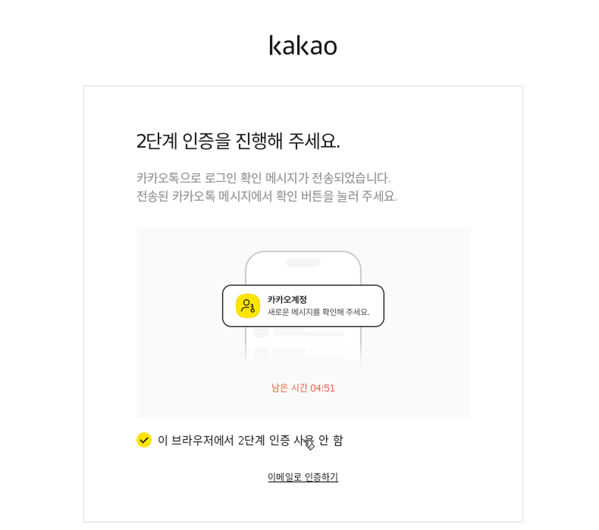

# 00-3. 피클에게 시키고 답장하기: 실전 대화 흐름

이 책의 뒤쪽 장에서는 글 규격, 티스토리 화면 구조, 워드프레스 설정, 애드센스와 검색엔진 등록을 자세히 다룹니다. 하지만 초급자가 피클(Pickle)로 블로그 자동화를 시작할 때 막히는 지점은 기술 용어가 아닙니다. 다음 두 가지입니다.

1. 피클에게 처음 어떤 말로 시켜야 하는가
2. 피클이 무언가를 물어볼 때 내가 무엇을 눌러야 하는가

이 절에서는 코드를 한 줄도 만지지 않습니다. 대화창에서 주고받는 흐름만 먼저 익힙니다. 여기서 익힌 방식이 02장부터 09장까지 그대로 반복됩니다.

---

## 1. 피클에게 일을 맡기는 세 문장

피클은 개발 도구가 아니라 옆에서 일을 처리해 주는 비서처럼 동작합니다. 그래서 순서만 지키면 됩니다. 목적, 조건, 수익 규칙 순서로 한 문장씩 말합니다.

| 순서 | 이렇게 말합니다 | 왜 필요한가 |
| --- | --- | --- |
| 목적 | 내 티스토리 블로그에 매일 글을 자동으로 올리고 싶어 | 무엇을 어디에 할지 정해집니다 |
| 조건 | 하루 10편, 편당 3,000~5,000자, 40~120분 간격 예약 | 결과물의 모양이 정해집니다 |
| 수익 규칙 | 글 하나당 쿠팡파트너스 링크 하나씩만 넣어줘 | 결과물에서 무엇을 거둘지 정해집니다 |

세 문장을 한 번에 다 말하지 않아도 됩니다. 첫 문장만 보내면 피클이 빠진 정보를 순서대로 물어봅니다. 예를 들어 "내 티스토리 블로그에 매일 글 올리게 해줘"라고 보내면, 어느 블로그인지, 분량은 얼마인지, 몇 시에 올릴지를 되묻습니다. 이때 표에 적힌 값처럼 짧게 답하면 됩니다.

프롬프트를 길게 잘 쓰는 요령보다 중요한 것은, 조건을 숫자로 말하는 것입니다. "알아서 잘 써줘"보다 "3,000~5,000자, 소제목 3~5개, 태그 10개"가 훨씬 정확한 결과를 냅니다.

---

## 2. 피클이 보내는 다섯 가지 응답과 내가 할 일

일을 맡기면 피클은 혼자 처리할 수 있는 일을 먼저 끝내고, 사용자의 확인이나 인증이 필요한 순간에만 채팅창에 카드나 질문을 띄웁니다. 아래 다섯 가지 중 무엇이 떴는지 보고 그대로만 대응하면 됩니다.

| 피클이 보낸 것 | 화면에 보이는 모습 | 사용자가 할 일 | 주의할 점 |
| --- | --- | --- | --- |
| 로그인 카드 | 아이디와 비밀번호 입력 칸이 있는 보안 카드 | 해당 사이트의 아이디·비밀번호를 카드 안에 입력하고 저장 | 채팅창에 비밀번호를 직접 타이핑하지 않습니다 |
| 인증 코드·2단계 인증 | "폰 알림에서 확인을 눌러주세요" 또는 6자리 코드 입력 카드 | 휴대폰 알림에서 승인한 뒤 채팅에 "완료"라고 답장 | 2~5분 안에 만료되므로 알림이 오면 바로 처리 |
| 선택 카드 | 1번, 2번, 3번 버튼이 달린 선택지 카드 | 원하는 버튼을 누르거나 "1, 2 진행"처럼 번호로 답장 | 여러 개를 동시에 고를 수 있는 카드도 있습니다 |
| 원격 화면 열기 | 피클이 연 웹사이트 화면이 내 폰에 그대로 뜸 | 보안문자(캡차) 입력이나 본인 확인만 직접 처리하고 "완료" | 로그인 상태는 피클 쪽에 유지되므로 처리 후 닫으면 됩니다 |
| 완료 보고 | 발행된 글 링크, 스크린샷, 요약 표 | 링크를 눌러 눈으로 확인하고 고칠 점만 짧게 피드백 | "대표이미지가 어색해", "문체가 너무 딱딱해"처럼 한 줄 |

위 화면처럼 휴대폰에 확인 창이 뜨는 경우가 가장 흔합니다. 이때 채팅창에는 "휴대폰에서 확인을 눌러 주세요"라는 안내가 함께 옵니다. 버튼을 누른 뒤 "완료"라고 답장하면 피클이 다음 단계로 넘어갑니다.

---

## 3. 실전 대화 시나리오 세 가지

실제로 블로그 자동화를 굴릴 때 오가는 대화를 그대로 옮겼습니다. 02장부터 09장에서 만나는 상황이 모두 여기에 들어 있습니다.

### 시나리오 A. 처음 티스토리 자동 발행을 붙일 때

1. 사용자: "내 티스토리 블로그에 매일 아침 10편씩 자동 발행되게 세팅해 줘."
2. 피클: "알겠습니다. 먼저 티스토리 로그인을 위해 보안 로그인 카드를 띄웠습니다. 아이디가 기억나지 않으면 '기억 안 남'을 눌러 주세요."
3. 사용자: 로그인 카드에 아이디와 비밀번호를 입력하고 저장.
4. 피클: "카카오 2단계 인증 알림이 갔을 것입니다. 카톡에서 확인을 눌러 주세요."
5. 사용자: 카톡 인증을 마치고 채팅에 "완료" 입력.
6. 피클: "로그인 확인했습니다. 오늘 첫 배치 10편을 예약 발행으로 걸어 두었고, 내일 아침 7시 15분 정기 루틴도 등록했습니다."

### 시나리오 B. 호스팅 트래픽 초과나 애드센스 반려가 났을 때

1. 피클: "워드프레스 호스팅의 일일 트래픽이 초과되어 오늘 예약이 멈췄습니다. 이미지 용량이 커서 생긴 문제이니, 자정에 한도가 초기화된 직후 가벼운 JPEG로 교체하고 애드센스 재검토까지 넣을까요?"
2. 사용자: "오케이, 자정에 바로 진행해."
3. 피클: (자정 이후 작업 중) "호스팅 관리자 인증번호 6자리 입력 카드를 띄웠습니다."
4. 사용자: 문자로 온 6자리를 카드에 입력.
5. 피클: "대표이미지 교체와 트래픽 복구를 마쳤고, 애드센스 재검토 요청까지 제출했습니다."

### 시나리오 C. 발행된 글의 품질이나 수익 규칙을 바꿀 때

1. 사용자: "오늘 올라간 글 보니까 제휴 링크가 한 글에 너무 많이 들어가서 지저분해. 글 하나당 링크 하나만 넣고, 쿠팡이랑 AI 툴을 번갈아 넣어줘."
2. 피클: "규칙을 바꿨습니다. 내일 발행분부터 1편당 제휴 링크 1개씩 교차 배치로 나갑니다."

이 세 장면에서 사용자가 한 일은 세 가지뿐입니다. 짧게 말하기, 카드에 인증하기, 결과를 보고 한 줄 피드백하기. 나머지는 피클이 처리합니다.

---

## 4. 처음 며칠의 순서

자동화를 한 번에 다 붙이면 어디서 멈췄는지 알기 어렵습니다. 첫 주는 다음 순서로 하나씩 붙이십시오.

1. 블로그 한 곳에 손으로 글 세 편을 씁니다. 문체와 구성을 정합니다.
2. 피클에게 규격표를 만들게 하고, 그 규격으로 한 편만 써 보게 합니다.
3. 티스토리 한 곳에 예약 발행을 걸어 봅니다.
4. 잘 되면 나머지 블로그로 늘립니다.
5. 애드센스와 검색엔진 등록은 그다음입니다.

각 단계에서 확인할 것은 "글이 올라갔는가"와 "내가 승인한 카드가 무엇이었는가" 두 가지입니다. 이 두 가지만 기억하면 전체 흐름을 놓치지 않습니다.

---

## 핵심 체크리스트

- [ ] 피클에게는 "목적, 조건, 수익 규칙" 순서로 짧게 말할 수 있다.
- [ ] 조건은 "알아서"가 아니라 숫자로 말한다.
- [ ] 비밀번호는 채팅창이 아니라 로그인 보안 카드에만 입력한다.
- [ ] 2단계 인증 알림을 승인한 뒤 "완료"라고 답장하면 다음 단계로 넘어간다.
- [ ] 보안문자가 뜨면 원격 화면에서 직접 입력하고 닫으면 된다.
- [ ] 완료 보고를 받으면 링크를 열어 눈으로 확인하고, 고칠 점만 한 줄로 말한다.
