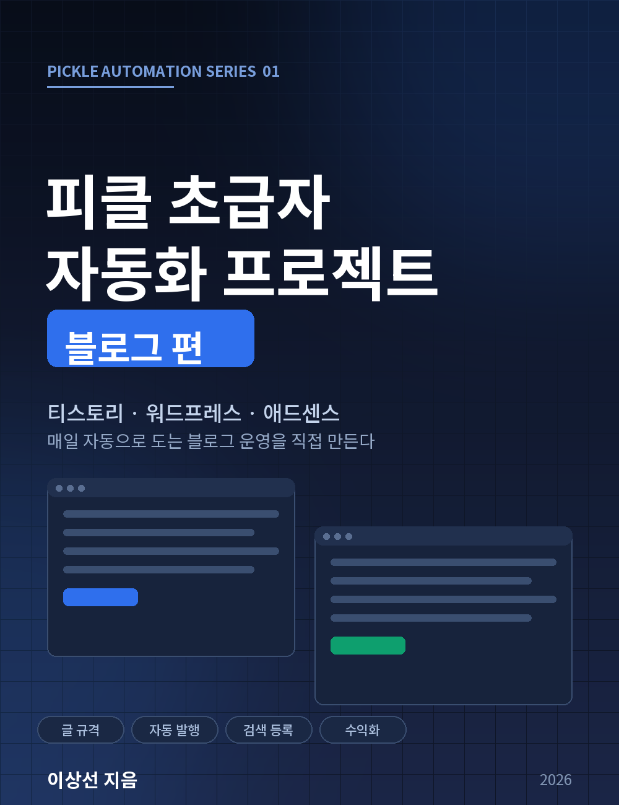

# 00. 들어가며

블로그를 시작하는 일은 어렵지 않습니다. 어려운 것은 계속하는 일입니다. 첫 달에는 글 세 편을 쓰고, 둘째 달에는 한 편을 쓰고, 셋째 달에는 로그인만 하고 닫습니다. 수익이 보이지 않기 때문입니다.

이 책은 그 지점을 다룹니다. 의지의 문제로 두지 않고, 운영 방식의 문제로 바꾸는 것이 목적입니다. 사람이 매일 해야 하는 일을 정해진 시각에 자동으로 돌게 만들고, 사람은 결과만 확인합니다.

다만 자동화를 실제로 붙여 보면 생각보다 많은 곳에서 막힙니다. 블로그 에디터는 밀어 넣은 본문을 저장하지 않습니다. 호스팅은 이미지 몇 개에 트래픽 한도를 넘기고 사이트 전체를 닫아 버립니다. 애드센스는 "가치가 별로 없는 콘텐츠"라는 문장 하나로 승인을 보류합니다. 이 책의 절반은 그 막힘을 어떻게 뚫었는지에 대한 기록입니다.

## 이 책의 약속

- 화면에 보이는 것과 실제로 저장되는 것이 다르다는 사실을 먼저 알려 줍니다.
- 숫자를 정합니다. "충분히 길게"가 아니라 3,000~5,000자, "적당히 여러 장"이 아니라 3~7장처럼 씁니다.
- 실패한 방법도 적습니다. 되지 않는 길을 두 번 걸어 보지 않게 하려는 것입니다.
- 계정, 비밀번호, 결제 정보, 개인 주소는 싣지 않습니다. 독자가 자기 값을 넣을 자리는 자리표시자로 표시했습니다.

다음 장에서 이 책이 어디까지 다루고 어디부터 다루지 않는지 밝히고, 그다음부터 실제 작업으로 들어갑니다.
