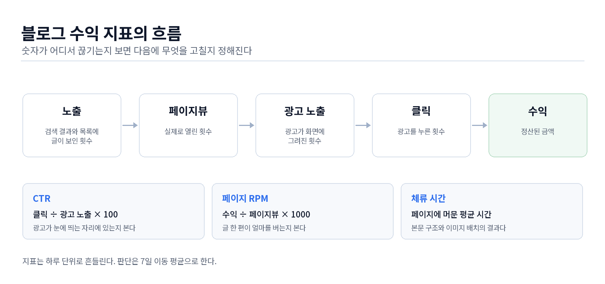

# 01-1. 블로그 수익은 어디서 오는가

블로그 수익의 대부분은 광고입니다. 광고 수익은 다음 순서로 만들어집니다.

1. 글이 검색 결과에 노출됩니다.
2. 누군가 그 글을 엽니다. 이것이 페이지뷰입니다.
3. 글에 붙은 광고가 화면에 그려집니다. 이것이 광고 노출입니다.
4. 누군가 광고를 누릅니다. 이것이 클릭입니다.
5. 광고주가 지불한 금액이 정산됩니다.

이 중에서 블로거가 직접 늘릴 수 있는 것은 앞의 두 단계입니다. 글이 노출되고 열리게 만드는 일입니다. 3번부터는 광고 시스템이 정합니다. 클릭률은 독자와 광고주가 만나는 지점이라 글의 주제와 독자 층이 결정합니다.

## 계산해 보기

페이지뷰 1,000회에 수익 2달러가 나오는 블로그를 가정합니다. 이것을 페이지 RPM이라고 부릅니다. 하루 300명이 방문하는 블로그라면 한 달에 약 9,000페이지뷰, 수익은 18달러입니다.

| 항목 | 값 |
| --- | --- |
| 하루 페이지뷰 | 300 |
| 한 달 페이지뷰 | 9,000 |
| 페이지 RPM | 2달러 |
| 한 달 수익 | 18달러 |

하루 300페이지뷰는 글 300편을 쌓고 나서야 나오는 숫자입니다. 여기서 두 가지를 알 수 있습니다.

첫째, 글 한 편의 가치는 생각보다 작습니다. 글 한 편이 하루에 한 번 읽히면 충분한 셈입니다.

둘째, 초기에는 수익이 보이지 않는 것이 정상입니다. 2026년 11월 실제 운영 중인 블로그 세 곳과 워드프레스 한 곳의 애드센스 계정 수익은 하루 기준 0달러에서 0.01달러 사이였습니다. 검색 유입이 붙는 데는 두세 달이 걸립니다.

## 그래서 자동화가 필요한 이유

하루 한 편으로는 300편을 만드는 데 1년 가까이 걸립니다. 손으로 쓰는 한계입니다. 발행량을 늘리는 방법은 세 가지뿐입니다.

- 사람을 늘린다. 비용이 듭니다.
- 글 한 편을 짧게 쓴다. 품질이 떨어지고 승인에서 걸립니다.
- 같은 품질을 자동으로 반복한다. 이것이 이 책의 방법입니다.

수익을 약속하는 책은 아닙니다. 다만 수익이 나올 때까지 버틸 수 있는 구조를 만드는 책입니다. 버티려면 발행이 멈추지 않아야 하고, 발행이 멈추지 않으려면 규격과 검수가 있어야 합니다.
