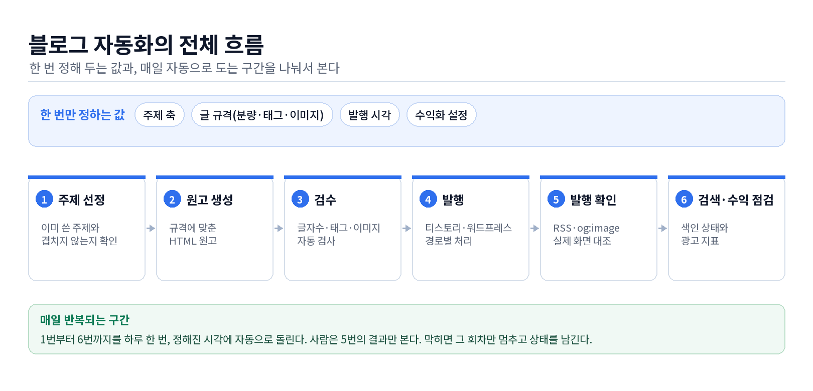

# 01. 블로그 자동화를 시작하는 이유

블로그를 자동화한다고 하면 흔히 두 가지를 상상합니다. 하나는 글을 인공지능이 대신 써 주는 것, 다른 하나는 손대지 않아도 돈이 들어오는 것입니다. 앞의 것은 지금도 가능하고, 뒤의 것은 사실이 아닙니다.

자동화가 실제로 바꾸는 것은 생산량이 아니라 지속성입니다. 사람은 하루에 두 편을 쓰다가 사흘을 쉬지만, 절차는 매일 같은 양을 냅니다. 검색 유입은 하루치 글의 양보다 몇 달치 글의 누적에 반응합니다. 그래서 자동화의 첫 번째 효과는 속도가 아니라 "끊기지 않음"입니다.

다만 끊기지 않으려면 조건이 있습니다. 매일 같은 품질이 나와야 하고, 실패했을 때 어디서 멈췄는지 알아야 하고, 비용이 감당 가능해야 합니다. 이 세 가지가 준비되지 않은 자동화는 사흘 만에 멈춥니다. 대개 원고가 규격을 벗어나거나, 호스팅이 한도를 넘거나, 계정에서 차단당하는 세 가지 이유입니다.

이 장에서는 그 세 가지를 미리 계산하기 위해, 수익이 만들어지는 경로와 자동화가 실제로 줄여 주는 범위를 먼저 확인합니다.
