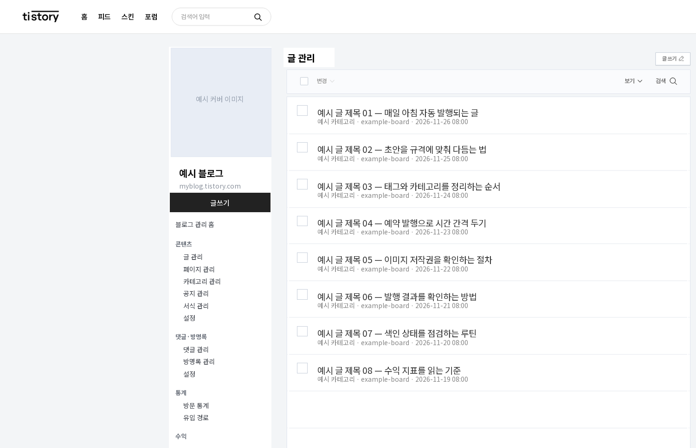

# 02-1. 계정 구조를 먼저 정한다

## 이 절에서 하는 일

자동화를 붙이기 전에 계정 세 개를 정리합니다. 이 정리가 끝나면 이후 모든 단계에서 로그인 카드가 한 번에 통과됩니다.

## 이렇게 말하면 됩니다

피클에게는 계정 구조를 점검해 달라고 말합니다. 아래 문장을 그대로 복사해서 보내면 됩니다.

```
블로그 자동화를 시작하려고 해. 내가 가진 계정을 정리해줘.
1. 티스토리 블로그와 연결된 카카오 계정
2. 워드프레스 관리자 계정과 그 호스팅 계정
3. 애드센스·구글 서치콘솔에 쓸 구글 계정
세 가지가 서로 같은 이메일로 묶여 있는지 확인하고, 다르면 어느 것을 기준으로 맞추면 좋을지 알려줘.
```

## 피클이 되묻는 것

| 피클의 질문 | 내가 고르는 답 |
| --- | --- |
| 티스토리는 어느 계정으로 로그인하나요 | 카카오 계정 이메일을 알려 주거나 로그인 카드에 직접 입력 |
| 워드프레스는 직접 설치한 사이트인가요, 호스팅에 딸린 사이트인가요 | 호스팅 업체 이름과 사이트 주소를 알려 줌 |
| 구글 계정은 여러 개인가요 | 애드센스를 쓸 계정 하나를 정해 알려 줌 |

## 내가 직접 하는 일

1. 세 계정의 이메일을 한 줄씩 적어 둡니다. 종이에 적어도 됩니다.
2. 피클이 로그인 카드를 띄우면 해당 사이트의 아이디와 비밀번호를 카드에 입력합니다.
3. 2단계 인증 알림이 오면 승인하고 "완료"라고 답장합니다.

## 실제 화면



위 화면처럼 티스토리는 카카오 계정 하나로 여러 블로그를 관리합니다. 화면 왼쪽 위 블로그 이름을 눌러 다른 블로그로 전환할 수 있습니다. 자동 발행을 붙일 때 피클이 블로그를 이름으로 찾기 때문에, 블로그 이름과 주소를 미리 정리해 두면 시행착오가 줄어듭니다.

## 계정을 하나로 묶는 기준

| 용도 | 계정 | 이유 |
| --- | --- | --- |
| 애드센스, 구글 서치콘솔, 구글 애널리틱스 | 구글 계정 하나 | 승인과 색인 확인이 한 화면에서 끝납니다 |
| 티스토리 블로그 여러 개 | 카카오 계정 하나 | 블로그 전환이 쉽고 쿠팡파트너스 연동도 한 번에 됩니다 |
| 워드프레스 | 호스팅 계정 + 워드프레스 관리자 계정 | 호스팅은 용량과 트래픽을, 관리자는 글 발행을 담당합니다 |
| 쿠팡파트너스 | 쿠팡 계정 하나 | 제휴 링크 발급에만 씁니다 |

이 네 줄이 정리되면 이후 장에서 "어느 계정으로 로그인할까요"를 다시 묻지 않습니다.

## 잘 안 될 때는 이렇게 말합니다

- "티스토리 로그인이 안 돼. 비밀번호를 잊은 것 같아."라고 말하면 피클이 계정 찾기 절차를 안내합니다. 비밀번호를 새로 만들지는 사용자가 결정합니다.
- "구글 계정이 두 개인데 어느 걸 써야 할지 모르겠어."라고 물으면, 애드센스가 이미 연결된 계정이 있는지 먼저 확인해 줍니다.
- "웹호스팅 아이디가 기억 안 나."라고 하면 결제 메일이나 호스팅 안내 메일에서 계정명을 찾아 줍니다.

## 참고: 왜 계정을 먼저 정하는가

자동화는 로그인 상태를 오래 유지합니다. 계정이 여러 개로 흩어져 있으면 사이트마다 다시 인증해야 하고, 한 곳에서 로그아웃되면 그 사이트의 예약 발행이 조용히 멈춥니다. 나중에 "글이 안 올라간다"는 문제의 절반은 계정이 아니라 로그인 상태에서 시작됩니다.
