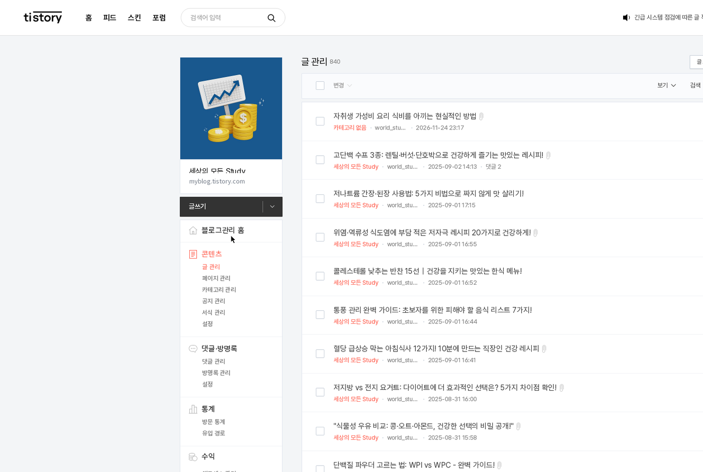

# 02-2. 티스토리 블로그 개설과 기본 설정

## 개설

1. `tistory.com`에 접속해 카카오 계정으로 로그인합니다.
2. 블로그 만들기에서 주소와 이름을 정합니다. 주소는 한 번 정하면 바꿀 수 없습니다.
3. 블로그 목록에서 새로 만든 블로그의 관리 화면으로 들어갑니다.

카카오 계정 하나로 여러 블로그를 만들 수 있습니다. 관리 화면 우측 상단의 블로그 목록에서 전환합니다.

위 화면에서 확인할 것은 세 가지입니다. 왼쪽 메뉴에 글 관리와 통계가 보이는지, 블로그 이름 아래 주소가 맞는지, 글 목록의 발행 시각이 최근 글까지 정상으로 표시되는지입니다.

## 개설 직후 바꿔야 하는 설정

| 설정 | 위치 | 값 |
| --- | --- | --- |
| 블로그 이름 | 관리 > 블로그 > 기본 정보 | 주제어를 포함한 이름 |
| 카테고리 | 관리 > 콘텐츠 > 카테고리 관리 | 글 주제에 맞춰 3~5개 |
| 홈주제 | 글 발행 화면 | 카테고리와 일치하는 주제 |
| 댓글 | 관리 > 댓글 > 설정 | 필요 없으면 닫기 |
| 수익 | 관리 > 수익 | 광고 수익 기능 켜기 |

카테고리는 나중에 늘리지 않는 편이 좋습니다. 자동 발행할 때 카테고리를 이름으로 찾아 배정하기 때문에, 이름이 비슷한 카테고리가 둘 이상 있으면 엉뚱한 곳에 글이 들어갑니다. 실제로 "요리"와 "요리 레시피"가 함께 있으면 후보가 갈립니다.

## 초기 글 세 편을 직접 쓴다

자동 발행을 붙이기 전에 손으로 세 편을 씁니다. 이유는 세 가지입니다.

- 이 블로그의 문체와 구성을 정합니다. 자동 생성 원고도 이 구성을 따르게 만듭니다.
- 카테고리와 홈주제가 맞물리는지 확인합니다.
- 검색엔진이 블로그를 인식할 최소한의 글을 확보합니다.

세 편이면 충분합니다. 열 편을 쓰고 나서야 자동화를 붙이면 시작이 한 달 늦어집니다. 세 편을 쓴 뒤 규격표를 만들고, 네 번째 글부터 자동으로 생성해 사람이 읽고 발행하는 방식으로 넘어갑니다.

## 스킨과 광고

스킨은 광고가 본문 사이에 들어갈 자리가 있는 것으로 고릅니다. 본문 중간 광고는 수익에 직접 영향을 줍니다. 티스토리의 수익 기능을 켜면 글마다 광고가 자동으로 삽입되지만, 일부 스킨에서는 본문 중간에 들어가지 않습니다. 발행한 글을 열어 광고 위치를 눈으로 확인하십시오.
