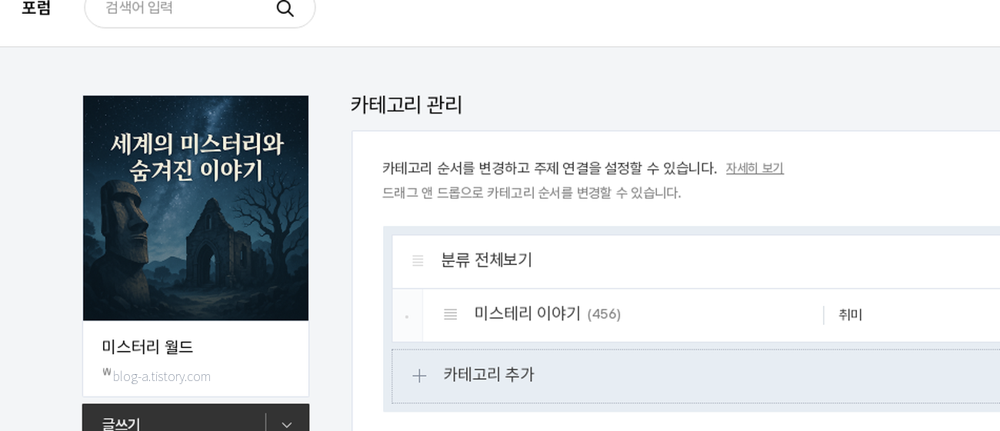

# 02-2. 티스토리 블로그 개설과 첫 설정

## 이 절에서 하는 일

티스토리 블로그를 직접 개설하고, 개설 직후에 바꿔야 하는 설정을 피클에게 점검시킵니다. 블로그 개설은 사람이 합니다.

## 내가 직접 하는 일

1. `tistory.com`에 접속해 카카오 계정으로 로그인합니다.
2. 블로그 만들기에서 주소와 이름을 정합니다. 주소는 한 번 정하면 바꿀 수 없습니다.
3. 블로그 목록에서 새로 만든 블로그의 관리 화면으로 들어갑니다.

카카오 계정 하나로 여러 블로그를 만들 수 있습니다. 관리 화면 왼쪽 위의 블로그 이름을 눌러 전환합니다.

## 이렇게 말하면 됩니다

개설을 마쳤으면 아래 문장을 그대로 보내 점검을 맡깁니다.

```
방금 티스토리 블로그를 새로 만들었어. 자동 발행을 붙이기 전에 설정을 점검해줘.
- 블로그 이름에 주제어가 들어가 있는지
- 카테고리가 3~5개로 정리되어 있는지
- 홈주제와 카테고리가 맞는지
- 댓글 설정과 수익 기능 상태
문제가 있으면 어디를 어떻게 바꾸면 되는지 순서대로 알려줘.
```

## 피클이 되묻는 것

| 피클의 질문 | 내가 고르는 답 |
| --- | --- |
| 블로그 주소를 알려 주세요 | 예: `blog-a.tistory.com` 형태의 주소 |
| 글 주제는 무엇인가요 | 예: IT·코딩 실습, 생활 정보, 여행 기록 |
| 광고 수익 기능을 켤까요 | 지금 켜기 / 승인 뒤에 켜기 중 선택 |

## 개설 직후에 바꿀 설정

| 설정 | 위치 | 값 |
| --- | --- | --- |
| 블로그 이름 | 관리 > 블로그 > 기본 정보 | 주제어를 포함한 이름 |
| 카테고리 | 관리 > 콘텐츠 > 카테고리 관리 | 글 주제에 맞춰 3~5개 |
| 홈주제 | 글 발행 화면 | 카테고리와 같은 주제 |
| 댓글 | 관리 > 댓글 > 설정 | 필요 없으면 닫기 |
| 수익 | 관리 > 수익 | 광고 수익 기능 켜기 |

카테고리는 나중에 늘리지 않는 편이 좋습니다. 자동 발행할 때 카테고리를 이름으로 찾아 배정하기 때문에, 이름이 비슷한 카테고리가 둘 이상 있으면 엉뚱한 곳에 글이 들어갑니다. 실제로 "요리"와 "요리 레시피"가 함께 있으면 후보가 갈립니다.



위 화면에서 카테고리 이름과 개수를 확인합니다. 드래그로 순서를 바꿀 수 있고, 오른쪽에서 주제 연결도 설정합니다.

## 손으로 세 편을 먼저 씁니다

자동 발행을 붙이기 전에 손으로 세 편을 씁니다. 이유는 세 가지입니다.

- 이 블로그의 문체와 구성을 정합니다. 자동 생성 원고도 이 구성을 따르게 만듭니다.
- 카테고리와 홈주제가 맞물리는지 확인합니다.
- 검색엔진이 블로그를 인식할 최소한의 글을 확보합니다.

세 편이면 충분합니다. 열 편을 쓰고 나서야 자동화를 붙이면 시작이 한 달 늦어집니다. 세 편을 쓴 뒤 규격표를 만들고, 네 번째 글부터 피클에게 맡깁니다.

## 스킨과 광고 자리

스킨은 광고가 본문 사이에 들어갈 자리가 있는 것으로 고릅니다. 본문 중간 광고는 수익에 직접 영향을 줍니다. 티스토리의 수익 기능을 켜면 글마다 광고가 자동으로 삽입되지만, 일부 스킨에서는 본문 중간에 들어가지 않습니다. 발행한 글을 열어 광고 위치를 눈으로 확인하십시오.

## 잘 안 될 때는 이렇게 말합니다

- "카테고리 이름이 자꾸 겹쳐. 하나로 합쳐줘."라고 하면 중복 카테고리를 정리하는 순서를 안내합니다.
- "스킨을 바꿨더니 광고가 안 보여."라고 하면 발행된 글에서 광고 위치를 확인하고, 다른 스킨 후보를 제안합니다.
- "블로그를 하나 더 만들고 싶어."라고 하면 같은 카카오 계정에 추가하는 절차를 안내하고, 자동 발행 목록에 추가해 줍니다.
