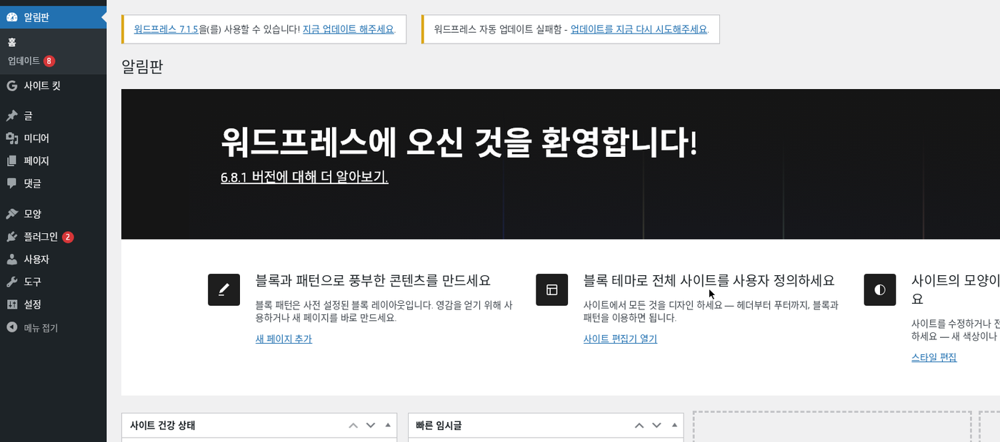

# 02-3. 워드프레스 설치와 도메인 연결

## 이 절에서 하는 일

워드프레스를 설치하고 도메인을 연결합니다. 설치 자체는 호스팅 업체의 자동 설치 기능을 쓰고, 설치 뒤의 확인은 피클에게 맡깁니다.

## 내가 직접 하는 일

1. 호스팅 업체에 가입하고 워드프레스 자동 설치를 신청합니다. 대부분 관리 화면에 "워드프레스 설치" 메뉴가 있습니다.
2. 관리자 아이디와 비밀번호를 정합니다. 이 값은 뒤에서 앱 비밀번호를 만들 때 다시 씁니다.
3. 도메인을 연결합니다. 호스팅에서 도메인을 샀다면 자동으로 연결되고, 외부에서 산 도메인이라면 네임서버나 A 레코드를 호스팅 안내에 맞게 바꿉니다.

## 이렇게 말하면 됩니다

설치를 마친 뒤 아래 문장을 보내면 사이트가 정상으로 열리는지, 자동 발행에 필요한 기능이 켜져 있는지 확인해 줍니다.

```
워드프레스 설치를 마쳤어. 사이트 주소는 https://blog.example.com 이야.
자동 발행을 붙이기 전에 점검해줘.
- 사이트가 관리자 화면까지 정상으로 열리는지
- 고유주소가 글로 주소가 되는지
- 검색엔진 공개 설정이 켜져 있는지
- 발행에 필요한 API 사용 설정이 켜져 있는지
```

## 피클이 되묻는 것

| 피클의 질문 | 내가 고르는 답 |
| --- | --- |
| 관리자 로그인 카드에 아이디와 비밀번호를 입력해 주세요 | 워드프레스 관리자 계정 입력 |
| 호스팅 관리자도 접속할까요 | 용량과 트래픽을 봐야 하므로 연결해 두는 것을 권장 |
| 도메인은 어디서 샀나요 | 호스팅 구매 / 외부 구매 중 선택 |

## 실제 화면



자동 설치를 마치면 위와 같은 관리자 화면이 열립니다. 여기서 왼쪽 메뉴가 보이면 설치가 끝난 것입니다. 왼쪽 메뉴가 보이지 않거나 화면이 깨지면 대부분 도메인 주소 문제이므로, 주소 끝의 `/wp-admin`을 직접 입력해 접속해 봅니다.

## 설치 직후에 바꿀 설정

| 설정 | 위치 | 값 |
| --- | --- | --- |
| 시간대 | 설정 > 일반 | 서울 |
| 고유주소 | 설정 > 고유주소 | 글 이름 |
| 검색엔진 공개 | 설정 > 읽기 | 체크 해제 |
| 사용자 표시 이름 | 사용자 > 프로필 | 사이트에 보일 이름 |
| 댓글 | 설정 > 토론 | 필요 없으면 닫기 |

고유주소는 날짜형이 아니라 `글 이름`으로 두십시오. 나중에 바꾸면 이미 발행한 글 주소가 모두 바뀌고, 바뀐 주소는 검색엔진에서 오류가 됩니다.

## 도메인 연결에서 자주 막히는 지점

- 도메인을 새로 샀다면 네임서버가 바뀌는 데 몇 시간이 걸릴 수 있습니다. 그동안은 호스팅이 준 임시 주소로 접속합니다.
- https가 붙지 않으면 호스팅의 무료 인증서 발급을 켭니다.
- `www`를 붙인 주소와 붙이지 않은 주소가 따로 열리면, 검색엔진이 서로 다른 사이트로 볼 수 있습니다. 한쪽으로 모읍니다.

## 잘 안 될 때는 이렇게 말합니다

- "사이트가 안 열려. 하얀 화면만 나와."라고 하면 도메인 연결과 인증서 상태를 차례로 확인합니다.
- "관리자 비밀번호를 잊었어."라고 하면 호스팅의 비밀번호 재설정 절차를 안내합니다. 비밀번호를 새로 만들지는 사용자가 결정합니다.
- "임시 주소로만 들어가져."라고 하면 네임서버가 아직 반영 중인지 확인해 줍니다.
