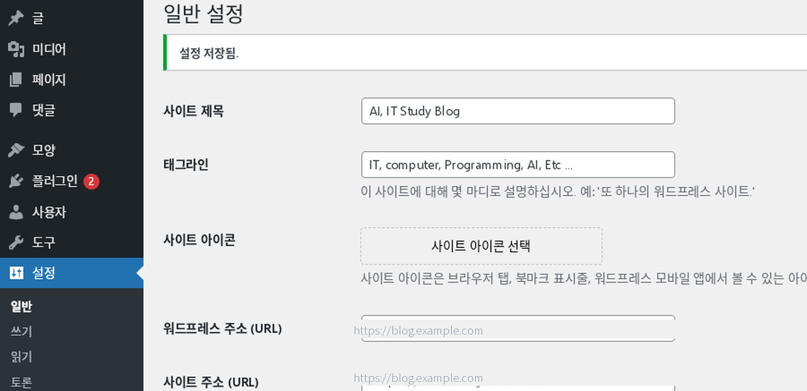

# 02-4. 워드프레스 기본 설정 다듬기

## 이 절에서 하는 일

설치가 끝난 워드프레스의 기본 설정을 피클에게 맡겨 정리합니다. 이 단계에서 정한 값이 뒤에 나오는 자동 발행 규격의 출발점이 됩니다.

## 이렇게 말하면 됩니다

```
워드프레스 기본 설정을 다듬어 줘.
- 시간대는 서울, 날짜와 시간 표기 형식은 익숙한 형태로
- 사이트 제목은 주제어가 들어가게, 태그라인은 한 줄로
- 고유주소는 글 이름으로
- 검색엔진 공개는 유지
- 댓글은 닫아 두고, 글 작성 화면은 방해 요소가 적은 형태로
바꾼 값은 표로 정리해서 보여줘.
```

## 피클이 되묻는 것

| 피클의 질문 | 내가 고르는 답 |
| --- | --- |
| 사이트 제목을 무엇으로 할까요 | 주제어가 들어간 10자 안팎의 이름 |
| 태그라인은 어떤 문장으로 할까요 | 블로그 성격을 한 줄로 요약한 문장 |
| 댓글을 정말 닫을까요 | 자동 발행만 한다면 닫기를 권장 |

## 실제 화면



위 화면에서 사이트 제목과 태그라인, 주소를 확인합니다. 주소는 실제 주소 대신 자리표시자로 가려 두었습니다. 이 화면에서 바꾼 값은 곧바로 사이트에 반영되므로, 바꾸기 전에 현재 값을 적어 두면 되돌리기 쉽습니다.

## 정리해 두면 좋은 값

| 항목 | 권장 값 | 이유 |
| --- | --- | --- |
| 시간대 | 서울 | 예약 발행 시각이 어긋나지 않습니다 |
| 고유주소 | 글 이름 | 주소가 짧고 검색에 유리합니다 |
| 검색엔진 공개 | 유지 | 검색엔진이 사이트를 읽을 수 있어야 합니다 |
| 기본 카테고리 | 주제와 같은 이름 하나 | 자동 발행이 카테고리를 찾기 쉽습니다 |
| 미디어 크기 | 기본값 | 대표이미지 크기를 규격으로 정합니다 |

## 자동 발행 전에 확인할 세 가지

1. 관리자 화면 오른쪽 위에 사용자 이름이 보이는가. 보이지 않으면 로그인이 풀린 것입니다.
2. 설정 > 일반에서 시간대가 서울로 되어 있는가. 예약 발행 시각이 여기서 결정됩니다.
3. 설정 > 읽기에서 검색엔진 공개가 켜져 있는가. 이 값이 꺼져 있으면 검색엔진이 사이트를 읽지 않습니다.

세 가지를 피클에게 한 번에 확인시키려면 이렇게 말합니다.

```
지금 워드프레스 관리자 화면에서 시간대, 고유주소, 검색엔진 공개 세 가지만 확인해서 표로 알려줘. 바꿔야 할 게 있으면 먼저 물어봐.
```

## 잘 안 될 때는 이렇게 말합니다

- "설정을 저장하면 화면이 멈춰."라고 하면 플러그인 충돌인지 확인합니다.
- "시간대를 바꿨는데 예약 시간이 그대로야."라고 하면 예약된 글의 시각은 따로 바꿔야 함을 안내합니다.
- "관리자 화면이 영어로 나와."라고 하면 언어 설정 위치를 알려 줍니다.
