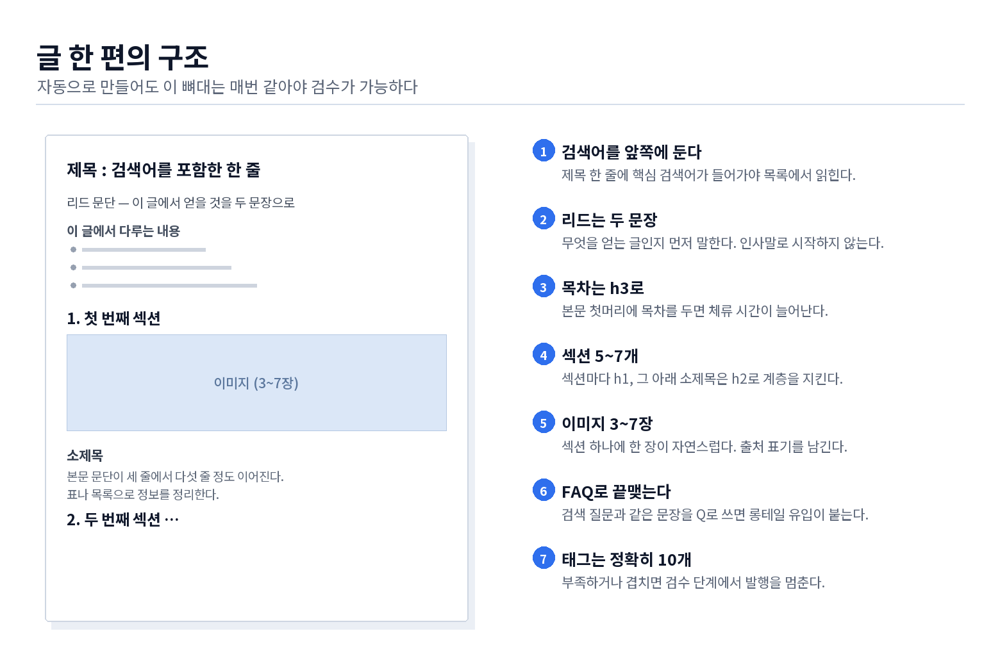

# 03-2. 분량과 문단 구조

## 글 한 편의 뼈대



구조는 일곱 칸으로 나뉩니다.

1. 제목. 검색어를 앞쪽에 둡니다. 30자 안팎이 목록에서 잘리지 않습니다.
2. 리드 문단. 이 글에서 무엇을 얻는지 두 문장으로 씁니다. 인사말로 시작하지 않습니다.
3. 목차. `이 글에서 다루는 내용` 아래에 항목 3~5개. 독자가 이탈하지 않게 합니다.
4. 섹션. h1으로 구분하고 5~7개를 둡니다. 섹션마다 이미지 한 장이 자연스럽습니다.
5. 소제목과 목록. 섹션 안은 h2 소제목, 필요하면 표나 목록으로 정리합니다.
6. 자주 묻는 질문. 검색 질의와 같은 문장을 Q로 씁니다. 롱테일 유입이 여기서 나옵니다.
7. 마무리와 출처. 이미지 출처를 한 줄로 남기고 끝냅니다.

## 분량을 세는 방법

분량은 공백을 포함한 글자 수로 셉니다. HTML을 그대로 세면 태그 길이가 섞이므로, 태그를 제거한 뒤 세야 합니다. 워드프로세서의 글자 수 세기와 같은 값이 나옵니다.

```python
import re, html

def count_chars(html_text):
    text = re.sub(r"<[^>]+>", " ", html_text)
    text = html.unescape(text)
    text = re.sub(r"\s+", " ", text).strip()
    return len(text)
```text

3,000자에서 5,000자 사이면 통과입니다. 이 범위에서 실제 발행한 글은 대개 3,500자 부근에 몰립니다.

## 문장 길이

문단은 세 줄에서 다섯 줄이 읽기 좋습니다. 한 문단이 화면을 넘기면 독자는 문단을 건너뜁니다. 문장은 한 호흡에 읽히는 길이로 끊습니다. 한 문장에 쉼표가 세 번 이상 들어가면 나눠 씁니다.

한국어 글에서 자주 생기는 문제는 같은 어미의 반복입니다. "~입니다"로 시작했으면 그 문단 안에서는 유지하고, 문단이 바뀔 때 호흡을 바꿉니다. 한 글 안에서 "~입니다"와 "~해요"가 번갈아 나오면 읽는 사람이 먼저 알아차립니다.

## 소제목 쓰는 법

- 소제목에는 검색어를 넣지 않아도 됩니다. 제목과 첫 문단이 그 역할을 합니다.
- 소제목만 읽어도 글의 흐름이 보여야 합니다. 목록처럼 나열해 보고 어색하면 다시 씁니다.
- 과장된 표현은 쓰지 않습니다. "완벽 정리", "궁극의 방법" 같은 말은 검색 결과에서 신뢰를 떨어뜨립니다.

## 표와 목록의 비중

3,000자 글에서 표나 목록이 두세 개 들어가면 읽는 속도가 달라집니다. 표는 비교, 목록은 절차에 씁니다. 문장으로 이어 쓸 수 있는 내용을 억지로 목록으로 만들면 오히려 읽기 어려워집니다.
