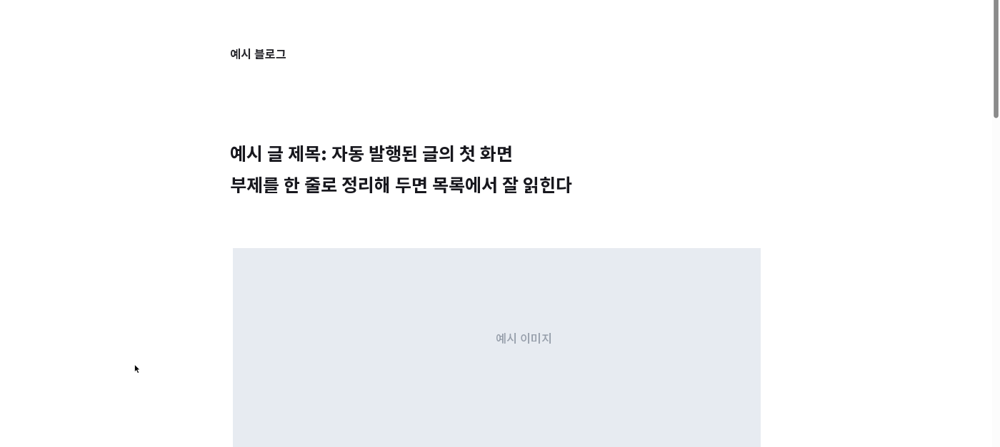

# 03-2. 분량과 문단 구조 정하기

## 이 절에서 하는 일

규격표에서 가장 자주 흔들리는 두 항목, 분량과 문단 구조를 숫자로 고정합니다. 이 두 값이 정해지면 원고의 모양이 매일 같아집니다.

## 분량은 한 구간으로 정합니다

"3,000자"처럼 한 값으로 정하면 원고가 매번 그 숫자에 맞춰 늘어나거나 줄어듭니다. 구간으로 정하는 편이 자연스럽습니다.

| 구간 | 언제 쓰는가 | 주의할 점 |
| --- | --- | --- |
| 1,500~2,500자 | 하루 여러 편을 짧게 내보낼 때 | 내용이 얇아지기 쉽습니다 |
| 3,000~5,000자 | 검색 유입을 노리는 일반 글 | 가장 무난한 구간입니다 |
| 5,000자 이상 | 비교·정리형 긴 글 | 주 1~2편이 적당합니다 |

처음에는 3,000~5,000자로 시작하십시오. 이 구간이 검색에서 불리하지 않으면서 쓰는 시간도 감당할 수 있습니다.

## 문단 구조는 네 층으로 고정합니다

| 층 | 규칙 | 예 |
| --- | --- | --- |
| 제목 | 핵심어를 앞에, 30자 안쪽 | 파이썬 업무 자동화 실전 5가지 |
| 도입 | 2~3문장, 무엇을 얻는지 | 이 글에서는 다섯 가지 예를 코드와 함께 정리합니다 |
| 소제목 | 3~5개, 각 소제목마다 3~5문단 | 무엇을, 어떻게, 얼마나 걸리는지 |
| 마무리 | 1~2문장, 다음 행동 | 오늘 하나만 골라 적용해 보십시오 |

문단은 2~4문장으로 끊습니다. 모바일에서 한 문단이 화면을 넘어가면 읽는 사람이 이탈합니다.


## 이렇게 말하면 됩니다

```
글쓰기 규격을 이렇게 고정해 줘.
- 분량: 공백 포함 3,000~5,000자
- 구조: 도입 2~3문장, 소제목 3~5개, 소제목마다 문단 3~5개, 마무리 1~2문장
- 문단: 2~4문장
- 말투: 짧은 존댓말, 한 문장에 한 가지 내용
앞으로 모든 원고에 이 규격을 적용하고, 규격을 벗어난 원고는 다시 써 줘.
```

## 피클이 되묻는 것

| 피클의 질문 | 내가 고르는 답 |
| --- | --- |
| 표를 넣을까요, 문단으로만 쓸까요 | 비교가 필요한 글에는 표를 넣기 |
| 소제목마다 이미지를 넣을까요 | 2~3개 소제목에만 넣기 |
| 숫자는 어느 정도까지 넣을까요 | 확인한 수치만 넣고 추정은 표시하기 |

## 실제 결과



위 화면은 규격을 정한 뒤 발행된 글입니다. 제목 아래에 요약이 있고, 본문이 소제목 단위로 나뉘며, 중간에 이미지가 들어갑니다. 독자는 이 구조만 봐도 글의 흐름을 짐작할 수 있습니다.

## 문체도 규격에 넣습니다

분량과 구조만 정하면 글마다 말투가 달라집니다. 문체는 다음 세 줄이면 충분합니다.

- 짧은 존댓말로 씁니다. "~합니다", "~하십시오"를 섞지 않고 하나로 통일합니다.
- 한 문장에 한 가지 내용만 담습니다.
- 감탄이나 과장 대신 확인한 사실과 예시를 씁니다.

## 잘 안 될 때는 이렇게 말합니다

- "글이 자꾸 5,000자를 넘어."라고 하면 소제목 수를 줄이는 쪽으로 조정합니다.
- "문단이 너무 길어."라고 하면 문단당 문장 수를 2~3개로 낮춥니다.
- "표가 너무 많아 읽기 어려워."라고 하면 표는 글당 두 개까지만 쓰도록 규격에 넣습니다.
