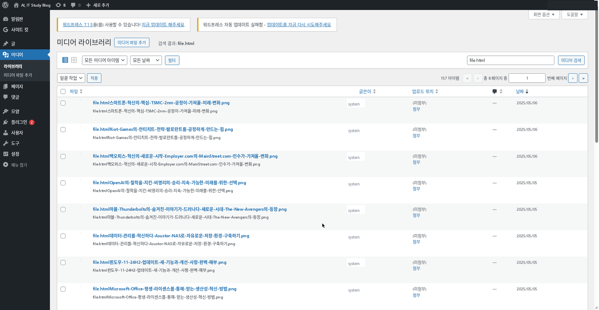

# 03-3. 이미지와 저작권

## 이미지 세 장의 역할

글 한 편에 이미지는 최소 세 장이 들어갑니다.

| 위치 | 역할 | 크기 |
| --- | --- | --- |
| 대표이미지 | 목록과 공유 미리보기 | 가로 1,200px 내외 |
| 본문 첫 이미지 | 첫 화면에서 읽는 사람을 붙잡음 | 가로 800~1,000px |
| 섹션 이미지 | 문단 사이 호흡 | 가로 600~800px |

대표이미지는 본문 이미지와 달라도 됩니다. 본문 이미지는 외부 이미지 주소를 그대로 쓰고, 대표이미지는 사이트에 업로드하는 방식이 용량 관리에 유리합니다. 이유는 09장에서 설명합니다.

## 저작권이 확실한 출처

| 출처 | 조건 | 표기 |
| --- | --- | --- |
| Pexels, Pixabay | 상업적 이용 가능, 출처 표기 권장 | 작성자명과 사이트 |
| Unsplash | 상업적 이용 가능, 재판매 금지 | 작성자명 |
| 위키미디어 공용 | 라이선스별로 다름 | 라이선스명 필수 |
| 직접 만든 이미지 | 제한 없음 | 표기 불필요 |

본문 말미에 한 줄로 남깁니다.

```text
이미지 출처: Pexels (CC0)
```text

## 하지 말아야 할 것

- 검색 이미지 결과에서 내려받아 쓰는 것. 대부분 출처가 표시되지 않은 상태이고, 그대로 쓰면 권리 침해입니다.
- 다른 블로그의 이미지를 대표이미지로 쓰는 것. 자동 수집한 이미지는 나중에 문제가 됩니다.
- 확장자만 믿는 것. 아래 사례는 이 책에서 실제로 겪은 일입니다.

## 확장자를 믿으면 생기는 일

자동 수집한 대표이미지 151개의 확장자는 모두 `.png`였습니다. 내려받아 확인해 보니 진짜 PNG는 한 장도 없었습니다.

| 실제 내용 | 개수 | 크기 |
| --- | --- | --- |
| 외신 기사 HTML 문서 | 140 | 약 800MB |
| 0바이트 파일 | 11 | 0 |
| 진짜 이미지 | 0 | 0 |

결과적으로 144편의 대표이미지가 처음부터 깨져 있었고, 서버는 HTML 문서를 이미지로 내보내고 있었습니다. 복구하는 데 하루가 걸렸고, 그 과정에서 트래픽 한도를 넘겨 사이트가 닫혔습니다.

해결은 단순합니다. 이미지를 받은 뒤 파일 앞부분 몇 바이트를 확인합니다.

```python
def is_real_image(path):
    with open(path, "rb") as f:
        head = f.read(12)
    return head.startswith(b"\x89PNG") or head.startswith(b"\xff\xd8\xff")
```text

PNG는 `89 50 4E 47`, JPEG는 `FF D8 FF`로 시작합니다. 이 두 줄이면 140장의 가짜 이미지를 1초에 걸러 냅니다.



위 화면은 파일명이 `.png`로 끝나지만 실제로는 웹 문서인 파일이 미디어 라이브러리에 쌓인 상태입니다. 썸네일이 보이지 않거나 회색으로 나오면 이 경우를 의심합니다.
