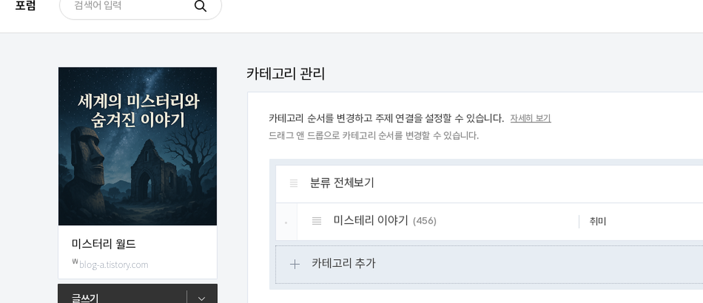

# 03-4. 태그와 카테고리 운용

## 이 절에서 하는 일

태그와 카테고리를 규칙으로 정합니다. 이 두 가지는 자동 발행에서 가장 자주 어긋나는 부분입니다. 카테고리는 이름으로 찾아 배정하고, 태그는 글마다 새로 만들어지기 때문입니다.

## 카테고리는 고정합니다

카테고리는 블로그를 만들 때 정한 3~5개를 그대로 씁니다. 자동 발행은 카테고리 이름을 기준으로 글을 넣기 때문에, 이름이 비슷한 카테고리가 늘어나면 엉뚱한 곳에 들어갑니다.

| 규칙 | 내용 |
| --- | --- |
| 개수 | 3~5개, 늘리지 않습니다 |
| 이름 | 짧고 겹치지 않게 (예: IT 실습, 생활 정보, 기록) |
| 기본값 | 글이 애매하면 들어갈 기본 카테고리를 하나 정합니다 |
| 확인 | 발행 뒤 목록에서 카테고리가 맞는지 눈으로 봅니다 |

## 태그는 열 개로 고정합니다

태그는 많다고 좋지 않습니다. 같은 블로그의 모든 글이 태그 10개라면 검색엔진이 주제를 안정적으로 잡습니다.

| 태그 종류 | 개수 | 예 |
| --- | --- | --- |
| 핵심 주제어 | 2~3개 | 파이썬, 업무 자동화 |
| 연관 검색어 | 3~4개 | 엑셀 자동화, 반복 작업 |
| 상황어 | 2~3개 | 직장인, 초보자 |
| 브랜드·시리즈 | 1개 | 실습 시리즈 |

태그는 띄어쓰기 없이 붙여 쓰는 경우가 많습니다. 같은 뜻의 태그를 두 가지 표기로 만들지 않도록 규칙에 적어 둡니다.

## 이렇게 말하면 됩니다

```
태그와 카테고리 규칙을 정해 줘.
- 카테고리는 지금 있는 것만 쓰고 새로 만들지 않기
- 글이 애매하면 기본 카테고리로 보내기
- 태그는 정확히 10개, 핵심 주제어 2~3개 + 연관 검색어 3~4개 + 상황어 2~3개 + 시리즈 1개
- 같은 뜻의 태그를 두 표기로 만들지 않기
- 발행 뒤에 카테고리와 태그가 규칙대로 들어갔는지 확인해서 알려 주기
```

## 피클이 되묻는 것

| 피클의 질문 | 내가 고르는 답 |
| --- | --- |
| 기본 카테고리는 어디로 할까요 | 가장 넓은 주제의 카테고리 |
| 태그에 브랜드명을 넣을까요 | 시리즈 이름이 있으면 넣기 |
| 카테고리를 새로 만들어야 하는 글이 나오면 | 만들지 말고 기본 카테고리로 보내기 |

## 실제 화면



카테고리 목록은 위 화면에서 확인합니다. 이름이 겹치거나 쓰지 않는 카테고리가 있으면 이 화면에서 정리합니다. 정리한 뒤에는 피클에게 "카테고리 목록이 바뀌었으니 다시 확인해 줘"라고 한 번 알려 주십시오.

## 잘 안 될 때는 이렇게 말합니다

- "글이 엉뚱한 카테고리에 들어가."라고 하면 카테고리 이름이 겹치는지 확인합니다.
- "태그가 20개씩 달려."라고 하면 태그 수를 규격에 다시 못 박습니다.
- "태그에 쓸데없는 단어가 섞여."라고 하면 금지어 목록(예: 광고성 단어)을 만들어 제외합니다.
