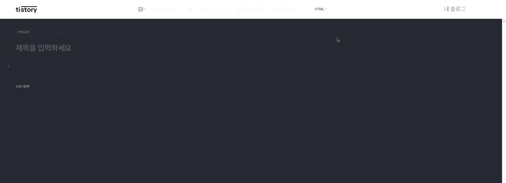

# 04-1. 발행을 맡기는 첫 프롬프트

## 이 절에서 하는 일

티스토리 자동 발행을 처음 맡기는 순간에 쓸 문장을 정리합니다. 이 한 번의 지시로 그 뒤 매일의 발행이 굴러갑니다.

## 이렇게 말하면 됩니다

처음에는 욕심을 내지 말고 한 블로그, 하루 한 편으로 시작하십시오. 잘 도는 것을 확인한 뒤 늘립니다.

```
내 티스토리 블로그 한 곳에 매일 아침 7시 15분에 글 한 편씩 자동 발행되게 해 줘.
- 분량은 공백 포함 3,000~5,000자, 소제목 3~5개
- 태그 10개, 무료 라이선스 이미지 3~7장과 대표이미지 1장
- 제휴 링크는 글 하나당 1개만
발행 전에 규격을 검수하고, 결과는 링크와 함께 보고해 줘.
```

잘 돌아가면 다음 문장으로 늘립니다.

```
같은 방식으로 하루 10편으로 늘려 줘. 오전에 1편은 바로 공개하고, 나머지 9편은 40~120분 사이 간격으로 예약 발행해 줘.
```

## 피클이 되묻는 것

| 피클의 질문 | 내가 고르는 답 |
| --- | --- |
| 어느 블로그에 올릴까요 | 블로그 주소나 이름을 알려 줌 |
| 글 주제는 어떻게 정할까요 | 블로그 주제와 이미 쓴 글 목록을 참고하게 함 |
| 카테고리는 어디로 넣을까요 | 규격표에서 정한 기본 카테고리 |
| 로그인 정보를 입력해 주세요 | 보안 로그인 카드에 직접 입력 |

## 내가 직접 하는 일

1. 로그인 카드가 뜨면 카카오 계정으로 로그인합니다.
2. 2단계 인증 알림이 오면 휴대폰에서 승인하고 "완료"라고 답장합니다.
3. 발행 보고가 오면 링크를 열어 글을 봅니다.

## 실제 화면



이 화면이 자동 발행의 목적지입니다. 카테고리 선택, 제목, 본문, 대표이미지, 발행 설정까지 다섯 군데를 채우면 글이 올라갑니다. 사람이 하면 5분 걸리는 일을 피클이 순서대로 처리합니다.

## 첫 발행에서 확인할 것

| 확인 | 어디서 | 정상 모습 |
| --- | --- | --- |
| 글이 공개되었는가 | 블로그 글 목록 | 제목과 대표이미지가 보임 |
| 본문이 비어 있지 않은가 | 글 상세 화면 | 문단이 이어짐 |
| 카테고리가 맞는가 | 글 목록의 카테고리 열 | 규격표에서 정한 카테고리 |
| 태그가 10개인가 | 글 상세 아래쪽 | 태그 10개 |
| 예약 글도 잡혔는가 | 관리 > 글 관리 | 예약 상태로 표시됨 |

## 잘 안 될 때는 이렇게 말합니다

- "발행은 됐는데 본문이 비어 있어."라고 하면 다시 발행하도록 요청합니다. 이 증상은 다음 절과 참고 절에서 다룹니다.
- "글이 두 번 올라갔어."라고 하면 중복 발행을 지우고, 같은 원고를 다시 보내지 않도록 정리합니다.
- "주제가 마음에 안 들어."라고 하면 이미 쓴 주제 목록을 기준으로 다시 고르게 합니다.
