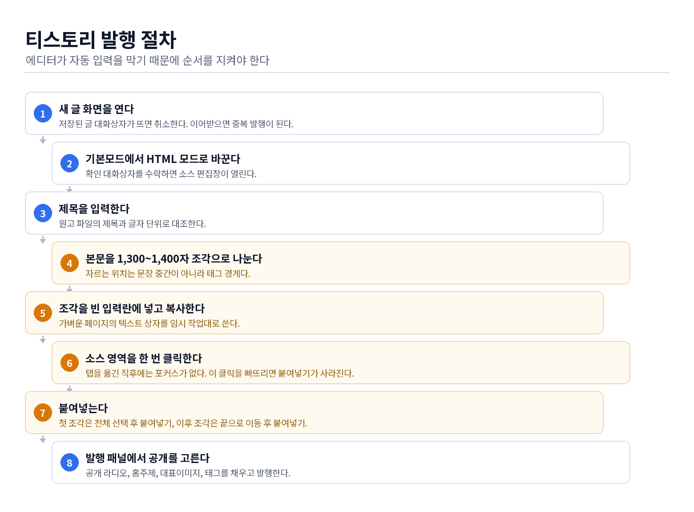

# 04-2. 붙여넣기 우회 절차

## 준비물

- 본문 HTML 파일 (검수 스크립트를 통과한 것)
- 빈 텍스트 상자가 있는 가벼운 페이지 하나. 임시 작업대로 씁니다. 예: `https://httpbin.org/forms/post`
- 클립보드 조작이 가능한 환경

## 본문을 조각으로 나누는 이유

한 번에 붙여넣으면 두 가지 문제가 생깁니다. 입력 도구가 한 번에 넣을 수 있는 글자 수에 한계가 있고, 긴 붙여넣기에서 일부가 누락되는 경우가 있습니다. 그래서 본문을 1,300~1,400자 단위로 나눕니다.

자르는 위치는 태그 경계입니다. `
`와 `
` 사이, `<h2>` 앞처럼 태그가 끊기지 않는 지점에서 자릅니다. 문장 중간에서 자르면 붙여넣은 뒤 태그가 열린 채로 남습니다.

## 열한 단계

1. `https://내블로그.tistory.com/manage/newpost/?type=post`를 엽니다.
2. "저장된 글이 있습니다" 대화상자가 뜨면 취소합니다. 이어받으면 이전 초안과 섞여 중복 글이 됩니다.
3. 작성 모드를 기본 모드에서 HTML로 바꿉니다. 확인 대화상자는 수락합니다.
4. 제목을 입력합니다. 원고 파일의 제목과 글자 단위로 대조합니다.
5. 본문을 조각으로 나눠 둡니다.
6. 첫 조각을 임시 작업대의 텍스트 상자에 넣고 전체 선택 후 복사합니다.
7. 티스토리 탭으로 돌아와 소스 영역을 한 번 클릭합니다.
8. 첫 조각은 전체 선택 후 붙여넣기, 이후 조각은 문서 끝으로 이동 후 붙여넣기합니다.
9. 소스 편집기의 전체 글자 수를 읽어 원본과 비교합니다.
10. 완료를 누르고 발행 패널을 엽니다.
11. 공개를 선택하고 홈주제, 대표이미지, 태그를 채운 뒤 발행합니다.

## 7단계가 핵심이다

탭을 옮긴 직후에는 소스 영역에 포커스가 없습니다. 이 상태에서 붙여넣기를 보내면 클립보드 내용이 사라지거나 엉뚱한 곳에 들어갑니다. 소스 영역을 한 번 클릭해 커서를 넣은 뒤에 붙여넣어야 합니다.

확인 방법은 간단합니다. 붙여넣은 뒤 소스 편집기의 전체 글자 수를 읽습니다. 원본과 10퍼센트 이상 차이 나면 그 조각은 들어가지 않은 것이므로 처음부터 다시 합니다.

## 실패 지점과 대응

| 증상 | 원인 | 대응 |
| --- | --- | --- |
| 붙여넣기가 통째로 사라짐 | 포커스 없음 | 소스 영역 클릭 후 다시 |
| 본문이 비어 발행됨 | 화면 주입 방식 사용 | 붙여넣기만 사용 |
| 태그 한 단어가 둘로 쪼개짐 | 쉼표 일괄 입력 | 발행 후 태그 목록 확인, 단어별 재입력 |
| 대표이미지가 붙지 않음 | 업로드 확인 누락 | 패널을 다시 열어 파일 선택 버튼이 삭제 버튼으로 바뀌었는지 확인 |
| 예약이 거부됨 | 현재 시각보다 이른 시각 | 발행 직전에 시각을 다시 계산 |
| 새 글에 초안 대화상자 | 직전 글의 자동 저장분 | 취소 |

이 표는 실제 실패 기록에서 뽑은 것입니다. 여섯 줄 중 다섯 줄이 "한 단계를 건너뛰어서" 생긴 일입니다. 절차를 줄이지 않는 것이 가장 빠른 길입니다.
