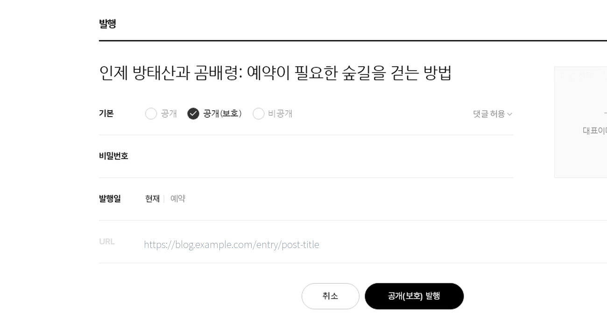

# 04-3. 발행 패널 채우기

## 이 절에서 하는 일

글이 완성된 뒤 마지막으로 채우는 발행 패널을 살펴봅니다. 공개 범위, 발행 시각, 주소가 여기서 정해집니다. 이 세 가지를 규칙으로 정해 두면 피클이 매번 같은 방식으로 채웁니다.

## 발행 패널에서 정하는 것

| 항목 | 선택지 | 권장 |
| --- | --- | --- |
| 공개 범위 | 공개 / 공개(보호) / 비공개 | 공개 |
| 비밀번호 | 공개(보호)일 때만 | 쓰지 않음 |
| 발행 시각 | 현재 / 예약 | 첫 편은 현재, 나머지는 예약 |
| 주소 | 제목 기반 자동 생성 | 그대로 사용 |



이 화면에서 실수하기 쉬운 곳은 공개 범위입니다. 공개(보호)가 선택되어 있으면 독자가 비밀번호를 입력해야 글을 볼 수 있고, 검색엔진은 글을 읽지 못합니다. 자동 발행에서는 항상 공개를 고르도록 규칙에 넣습니다.

## 이렇게 말하면 됩니다

```
발행 패널은 항상 이렇게 채워 줘.
- 공개 범위는 공개, 비밀번호는 쓰지 않기
- 첫 편은 현재 시각에 바로 공개, 나머지는 예약
- 주소는 제목 기반으로 자동 생성된 그대로 사용
- 댓글과 공감은 기본값 유지
채운 뒤에는 공개 범위와 발행 시각을 표로 보고해 줘.
```

## 피클이 되묻는 것

| 피클의 질문 | 내가 고르는 답 |
| --- | --- |
| 예약 시각을 몇 시부터 시작할까요 | 첫 예약은 1~2시간 뒤 |
| 같은 시각에 여러 편이 겹쳐도 될까요 | 겹치지 않게 간격을 둠 |
| 주소를 직접 정할까요 | 자동 생성 그대로 사용 |

## 예약 시각을 정하는 요령

- 블로그 세 곳에 같은 시각에 올리면 검색엔진이 중복으로 볼 수 있습니다. 블로그마다 시작 시각을 15분씩 어긋나게 둡니다.
- 하루 10편을 40~120분 간격으로 벌리면 대략 07시부터 23시 사이에 퍼집니다.
- 첫 편만 바로 공개하면 검색엔진이 새 글을 빨리 발견합니다.

## 발행 뒤에 볼 것

| 확인 | 정상 | 문제일 때 |
| --- | --- | --- |
| 글 목록의 상태 | 공개 | 비공개·보호로 되어 있으면 다시 설정 |
| 발행 시각 | 예약한 시각 | 현재로 되어 있으면 예약이 풀린 것 |
| 주소 | 제목 기반 | 무작위 문자열이면 주소 규칙 확인 |

## 잘 안 될 때는 이렇게 말합니다

- "글이 비공개로 올라갔어."라고 하면 공개 범위를 다시 설정하고, 왜 바뀌었는지 확인합니다.
- "예약이 안 걸리고 바로 올라가."라고 하면 예약 시각이 과거인지 확인합니다.
- "주소가 이상한 문자로 나와."라고 하면 제목에 특수문자가 들어갔는지 확인합니다.
