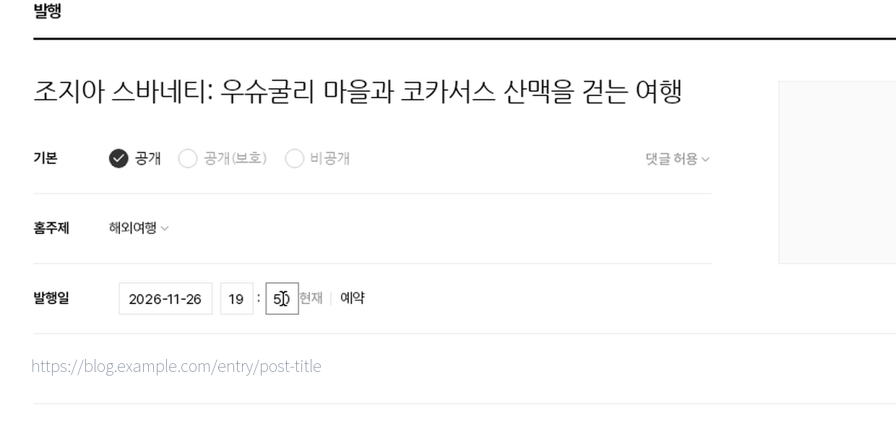
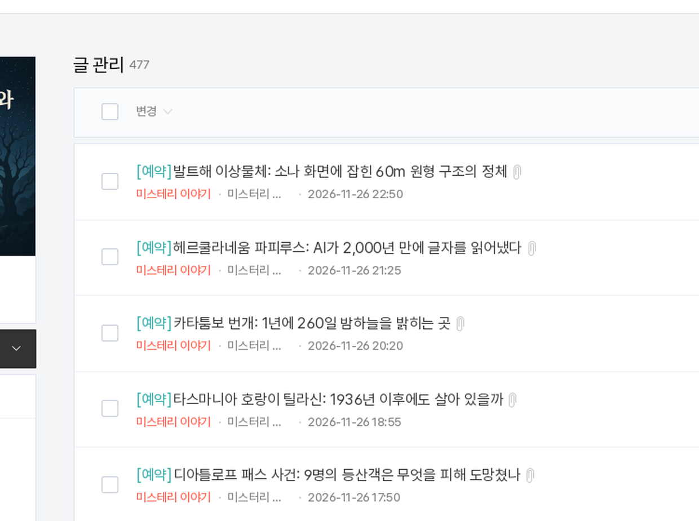

# 04-4. 40분 간격 예약으로 하루 10편 만들기

## 이 절에서 하는 일

하루 10편을 한꺼번에 올리지 않고 시간 간격을 두고 예약하는 방법을 정리합니다. 같은 양이라도 올리는 방식에 따라 검색엔진과 독자가 받아들이는 인상이 달라집니다.

## 왜 간격을 두는가

- 10편이 동시에 올라가면 블로그 목록이 한 주제로만 채워집니다. 다른 주제의 글이 묻힙니다.
- 검색엔진은 갑자기 쏟아진 글을 저품질로 볼 수 있습니다.
- 예약 발행은 하루 종일 조금씩 새 글이 올라오는 것처럼 보입니다.

## 간격 설계

| 블로그 | 첫 편 | 예약 간격 | 마지막 편 |
| --- | --- | --- | --- |
| A | 07:30 공개 | 40~120분 랜덤 | 23시 전후 |
| B | 07:45 공개 | 40~120분 랜덤 | 23시 전후 |
| C | 08:00 공개 | 40~120분 랜덤 | 23시 전후 |

간격을 고정하지 않고 범위로 두는 이유는, 같은 시각에 규칙적으로 올라가는 패턴이 기계적으로 보이지 않게 하기 위해서입니다. 피클에게는 "40~120분 사이에서 겹치지 않게"라고만 말하면 됩니다.


## 이렇게 말하면 됩니다

```
티스토리 세 블로그에 하루 10편씩 예약 발행해 줘.
- 각 블로그 첫 편은 아침에 바로 공개
- 나머지 9편은 40~120분 사이 간격으로 오늘 안에 끝나게 예약
- 세 블로그의 시작 시각은 15분씩 어긋나게
- 예약이 걸린 글 목록을 표로 보고해 줘
```

## 피클이 되묻는 것

| 피클의 질문 | 내가 고르는 답 |
| --- | --- |
| 오늘 안에 다 올릴까요, 내일로 넘겨도 될까요 | 오늘 안에 끝내기 |
| 예약 시각이 겹치면 어떻게 할까요 | 겹치지 않게 다시 배치 |
| 주제가 겹치는 글이 나오면 | 이미 쓴 주제 목록과 비교해 제외 |

## 실제 화면



발행일에서 현재와 예약 중 예약을 고르면 날짜와 시각 입력란이 열립니다. 자동 발행에서는 이 값을 피클이 계산해 넣습니다.



글 관리 화면을 열면 예약된 글이 시각과 함께 표시됩니다. 위 화면처럼 시간 간격이 벌어져 있으면 정상입니다. 같은 시각에 여러 편이 몰려 있으면 다시 배치를 요청하십시오.

## 예약 발행에서 자주 나는 문제

| 증상 | 원인 | 대응 |
| --- | --- | --- |
| 예약한 시각에 글이 안 올라옴 | 예약 시각이 과거이거나 저장이 안 됨 | 글 관리에서 상태 확인 |
| 예약이 모두 같은 시각 | 간격 계산이 빠짐 | 범위를 다시 말해 재배치 |
| 예약 글이 임시저장으로 남음 | 발행 버튼까지 누르지 않음 | 다시 발행 요청 |

## 잘 안 될 때는 이렇게 말합니다

- "예약이 밤 11시를 넘어가."라고 하면 마지막 편 시각을 앞당기게 조정합니다.
- "오늘 10편이 안 되고 7편만 잡혔어."라고 하면 남은 편을 보충 발행으로 채웁니다.
- "예약 글을 취소하고 싶어."라고 하면 취소할 글의 제목을 알려 주고 확인을 받습니다.
