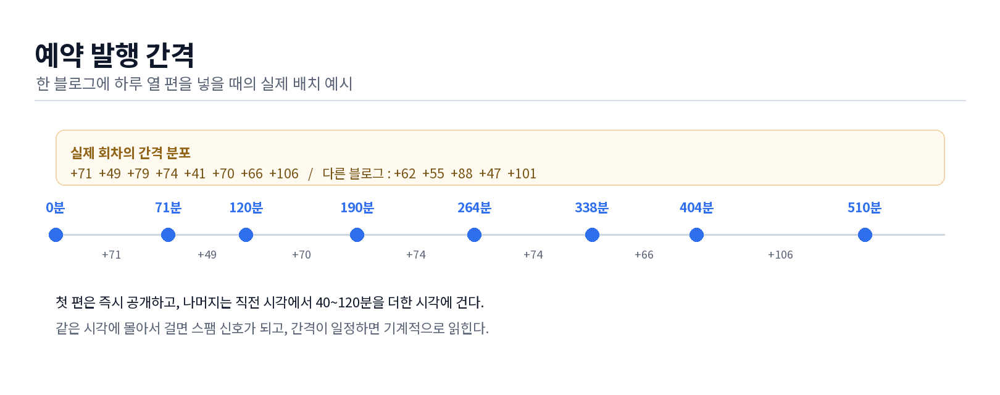

# 04-4. 예약 발행 간격 설계



## 왜 간격을 두는가

하루 열 편을 모두 같은 시각에 예약하면 두 가지 손해가 생깁니다.

- 같은 시각에 열 편이 올라가면 스팸 신호로 읽힙니다.
- 검색엔진이 새 글을 확인하는 주기는 짧기 때문에, 몰아 올린 글 중 뒤쪽은 첫 노출 기회를 잃습니다.

반대로 간격이 정확히 60분으로 일정하면 기계적으로 보입니다. 사람이 쓴 블로그도 일정한 경우가 있지만, 자동 발행이라는 것이 드러나면 신뢰가 떨어집니다.

## 기준값

| 항목 | 값 |
| --- | --- |
| 첫 편 | 즉시 공개 |
| 나머지 | 직전 시각 + 40~120분 랜덤 |
| 하루 편수 | 블로그당 10편 |
| 예약 시각 저장 | 상태 파일에 고정 |

기준 시각은 `max(직전 예약 시각, 현재 시각 + 40분)`입니다. 현재 시각보다 이른 시각을 예약하면 티스토리가 거부합니다. 발행 직전에 시각을 다시 계산하는 이유입니다.

실제로 한 블로그에 걸린 간격은 `+71, +49, +79, +74, +41, +70, +66, +106`분이었고, 다른 블로그는 `+62, +55, +88, +47, +101`분이었습니다. 이 정도 흔들림이면 사람이 쓴 것과 구분되지 않습니다.

## 계산 코드

```python
import random
from datetime import datetime, timedelta

def next_slot(last_published, now):
    base = max(last_published, now + timedelta(minutes=40))
    gap = random.randint(40, 120)
    return base + timedelta(minutes=gap), gap
```

## 실패한 두 가지 방식

| 방식 | 문제 |
| --- | --- |
| 30분 고정 간격 | 하루 열 편이 4시간 안에 끝나, 나머지 20시간 동안 새 글이 없음 |
| 무작위 시각을 매번 새로 계산 | 다음 회차에서 간격이 겹쳐 두 글이 같은 시각에 걸림 |

두 번째가 특히 위험합니다. 예약 시각을 상태 파일에 남기지 않고 매번 계산하면, 이전 회차의 예약분과 새 예약분이 충돌합니다. 회차를 거듭할수록 같은 시각에 두 편씩 쌓입니다.

## 상태 파일에 남길 것

```json
{
  "blog-a": {"last_slot": "2026-11-26T21:40:00+09:00", "count": 10},
  "blog-b": {"last_slot": "2026-11-26T22:05:00+09:00", "count": 10}
}
```

다음 회차는 이 값 이후부터 계산합니다. 사람이 읽어도 오늘 몇 편이 어디까지 걸렸는지 알 수 있어야 합니다.

## 블로그가 여러 개일 때

블로그마다 마지막 시각이 다릅니다. 하나의 변수로 관리하면 블로그 간 간격이 뒤섞여, 한 블로그에 두 편이 같은 시각에 걸립니다. 블로그 이름을 키로 하는 사전으로 관리하십시오.

## 예약을 걸지 말아야 할 때

- 원고가 검수를 통과하지 못했을 때
- 대표이미지가 준비되지 않았을 때
- 같은 주제가 최근 일주일 안에 발행되었을 때

이 세 경우는 예약을 미루는 편이 낫습니다. 빈 자리를 채우려고 아무 글이나 올리면, 그 글이 블로그의 주제 일관성을 깨고 검색 신뢰도를 떨어뜨립니다.
