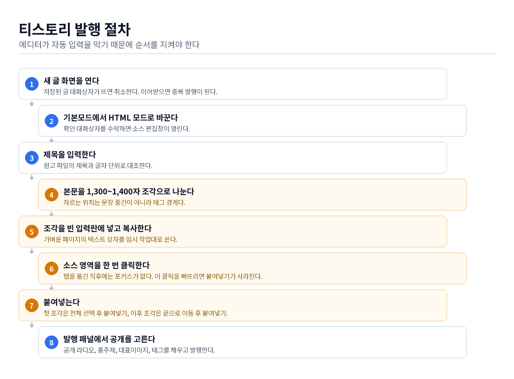

# 04-5. 참고: 에디터가 자동 입력을 막는 지점

이 절은 참고용입니다. 앞의 절까지 따라 하는 데는 필요하지 않습니다. "왜 어떤 날은 발행이 두 번 걸리는가"가 궁금할 때 읽으십시오.

## 에디터는 세 층으로 되어 있다

티스토리의 새 글쓰기 화면은 겉으로 보이는 편집 영역과, 실제로 저장되는 데이터, 그 사이에서 입력을 처리하는 편집기로 나뉩니다. 자동화가 실패하는 지점은 이 셋이 어긋나는 곳입니다.

| 층 | 보이는 것 | 역할 |
| --- | --- | --- |
| 화면 | 글자가 보이는 영역 | 사람이 보는 결과 |
| 저장 데이터 | 발행 요청에 담기는 값 | 실제로 글이 되는 내용 |
| 입력 처리 | 키보드와 붙여넣기를 받는 부분 | 화면과 데이터를 잇는 통로 |



## 실패하는 세 가지 방식

첫째, 화면에는 글이 보이는데 발행하면 본문이 빈 경우입니다. 편집 영역의 글자 수는 3,000자를 넘지만 발행 요청의 본문 길이가 0에 가깝습니다. 화면과 저장 데이터가 따로 움직인 것입니다.

둘째, 글자를 한 자씩 입력하면 몇 자마다 커서가 본문 중앙으로 튀는 경우입니다. 입력 속도가 사람보다 빨라서 편집기가 위치를 다시 계산하는 사이에 입력이 끼어드는 것으로 보입니다. 결과는 문단이 뒤섞인 글입니다.

셋째, HTML 모드의 소스창이 입력을 받지 않는 경우입니다. 소스창에 값을 넣어도 편집기가 입력을 가로채 아무것도 들어가지 않습니다.

## 붙여넣기는 왜 되는가

붙여넣기는 편집기가 직접 처리하는 사건입니다. 클립보드의 내용이 편집기의 정리 과정을 거쳐 저장 데이터로 들어갑니다. 즉 편집기가 허용하는 대량 입력 경로입니다. 그래서 자동 발행은 본문을 "입력"하는 대신 "복사해 두고 붙여넣는" 일을 대신합니다.

## 이 구조를 모르고 하면 생기는 일

- 발행은 되는데 본문이 비어, 목록에 제목만 보이는 글이 쌓입니다.
- 문단이 깨진 글이 올라가 검색엔진이 문장을 이해하지 못합니다.
- 실패한 회차를 다시 돌리면서 같은 글이 두 번 발행됩니다.

## 그래서 지켜야 할 세 가지 규칙

1. 한 번에 너무 많은 편을 몰아 발행하지 않습니다. 원고 생성과 발행을 나눠서 진행합니다.
2. 발행 직후 목록에서 본문 길이와 상태를 확인합니다.
3. 같은 원고를 다시 보낼 때는 먼저 중복 발행이 있었는지 확인합니다.

이 세 가지를 피클에게 맡기려면 이렇게 말합니다.

```
발행이 끝나면 글마다 본문 길이와 공개 상태를 확인해서 표로 보고해 줘. 본문이 비어 있거나 두 번 올라간 글이 있으면 알려 줘.
```
