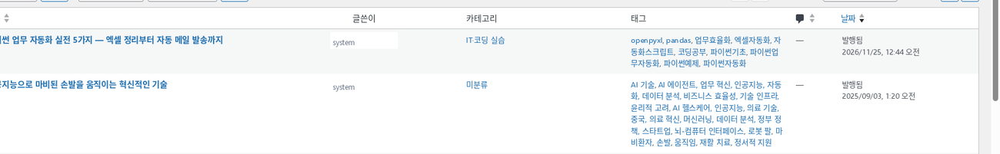

# 05-1. 발행을 맡기는 첫 프롬프트

## 이 절에서 하는 일

워드프레스에 자동 발행을 처음 맡길 때 쓸 문장을 정리합니다. 티스토리와 거의 같지만, 워드프레스에서만 필요한 조건이 두 가지 있습니다.

## 이렇게 말하면 됩니다

```
내 워드프레스 사이트에 매일 아침 7시 45분에 글 10편을 자동 발행되게 해 줘.
- 분량은 공백 포함 3,000~5,000자, 소제목 3~5개, 태그 10개
- 무료 라이선스 이미지 3~7장, 대표이미지는 1200x630으로 지정
- 카테고리는 IT·코딩 실습 하나만 사용
- 첫 편은 바로 공개, 나머지는 40~120분 간격으로 예약
발행 전에 규격을 검수하고, 끝나면 글 목록 링크와 함께 보고해 줘.
```

## 피클이 되묻는 것

| 피클의 질문 | 내가 고르는 답 |
| --- | --- |
| 사이트 주소를 알려 주세요 | 예: `https://blog.example.com` |
| 관리자 계정으로 로그인할까요 | 로그인 카드에 아이디와 비밀번호 입력 |
| 발행에 쓸 비밀번호를 따로 만들까요 | 앱 비밀번호를 만들어 쓰기 |
| 미디어 파일을 직접 올릴까요, 외부 주소를 쓸까요 | 처음에는 외부 주소, 안정되면 직접 업로드 |

## 내가 직접 하는 일

1. 로그인 카드에 워드프레스 관리자 계정을 입력합니다.
2. 앱 비밀번호를 만들 때 화면에 뜨는 값을 복사해 카드에 저장합니다.
3. 발행 보고를 받으면 글 목록을 열어 확인합니다.

## 실제 화면



자동 발행이 자리를 잡으면 글 목록이 이렇게 채워집니다. 확인할 것은 세 가지입니다. 상태가 공개인지, 발행 시각이 의도한 간격인지, 카테고리가 맞는지.

## 티스토리와 다른 두 가지

| 항목 | 티스토리 | 워드프레스 |
| --- | --- | --- |
| 발행 방법 | 화면을 거쳐 붙여넣기 | 정해진 통로로 직접 전송 |
| 인증 | 카카오 2단계 인증 | 관리자 계정 + 앱 비밀번호 |
| 실패했을 때 | 대개 화면에 드러남 | 조용히 실패하는 경우가 있음 |
| 확인 지점 | 글 목록의 상태 | 글 목록의 상태 + 사이트 접속 |

## 첫 발행에서 확인할 것

| 확인 | 정상 모습 |
| --- | --- |
| 글이 공개되었는가 | 목록 상태가 공개 |
| 사이트에서 열리는가 | 글 주소로 접속해 본문이 보임 |
| 대표이미지가 보이는가 | 목록과 공유 미리보기에 이미지가 보임 |
| 카테고리와 태그 | 지정한 카테고리 하나, 태그 10개 |

## 잘 안 될 때는 이렇게 말합니다

- "발행이 됐다는데 사이트에 안 보여."라고 하면 캐시와 공개 상태를 확인합니다.
- "이미지가 깨져."라고 하면 외부 이미지 주소가 살아 있는지 확인하고 직접 업로드로 바꿉니다.
- "글이 영어로 나와."라고 하면 언어 설정과 원고 언어를 확인합니다.
