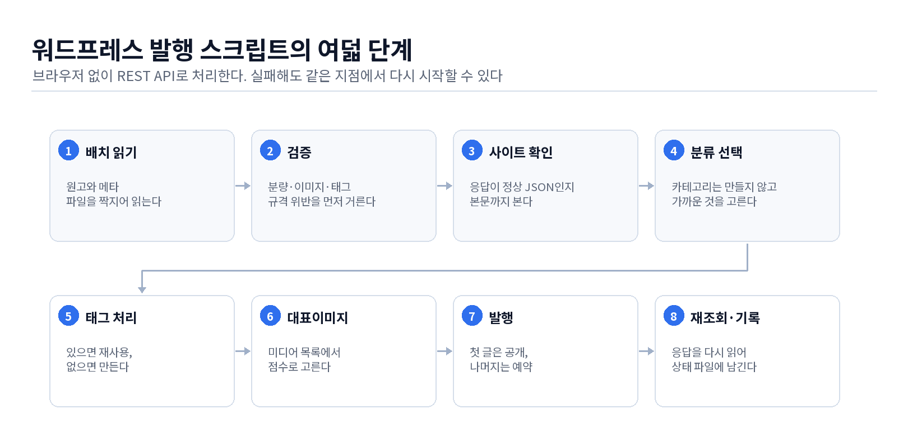

# 05-2. 발행 스크립트의 여덟 단계



## 전체 구조

```bash
python3 publish_batch.py --dry-run    # 검사만
python3 publish_batch.py             # 실제 발행
```

종료 코드는 세 가지입니다.

| 코드 | 의미 | 처리 |
| --- | --- | --- |
| 0 | 성공 | 다음 회차로 |
| 2 | 사이트 차단 또는 응답 이상 | 아무것도 만들지 않고 종료 |
| 3 | 원고 검사 실패 | 해당 배치 발행 중단 |

## 1단계: 배치 읽기

원고는 `NN.html`과 `NN.meta.json` 한 쌍으로 둡니다. 메타 파일에는 제목, 슬러그, 태그, 카테고리 후보를 적습니다.

```json
{
  "title": "파이썬으로 업무 자동화를 시작하는 5가지 예",
  "slug": "python-work-automation-5-examples",
  "tags": ["파이썬", "자동화", "업무자동화", "엑셀", "크롤링",
           "스크립트", "생산성", "직장인", "초보", "실습"],
  "category_candidates": ["IT·코딩 실습", "IT"]
}
```

## 2단계: 검사

03-5의 검수 스크립트를 그대로 호출합니다. 실패가 있으면 3으로 종료합니다. 실제 발행 전에 거르는 단계이므로, 여기서 통과하지 못한 원고는 사이트에 아무 흔적도 남기지 않습니다.

## 3단계: 사이트 확인

`/wp-json/`을 호출해 응답이 JSON인지 봅니다. JSON이 아니면 2로 종료합니다. 이 단계가 있는 이유는 호스팅 장애 때 반쯤 발행되는 상황을 막기 위해서입니다.

## 4단계: 카테고리 선택

후보 이름을 공백과 기호를 제거해 비교하고, 부분 일치하는 것을 고릅니다. 없으면 기본 카테고리로 보냅니다. 새 카테고리를 만들지 않는 것이 원칙입니다. 만들면 실행할 때마다 카테고리가 늘어납니다.

## 5단계: 태그 처리

이름으로 검색해 정확히 일치하면 재사용하고, 없으면 만듭니다. 태그는 카테고리와 달리 늘어나도 구조가 흐트러지지 않으므로 생성해도 됩니다.

```python
def ensure_tag(s, name):
    r = s.get(f"{s.base}/wp-json/wp/v2/tags", params={"search": name})
    for t in r.json():
        if t["name"] == name:
            return t["id"]
    r = s.post(f"{s.base}/wp-json/wp/v2/tags", json={"name": name})
    return r.json()["id"]
```

## 6단계: 대표이미지

새로 업로드하지 않고 기존 미디어 목록에서 고릅니다. 제목과 파일명을 키워드로 점수화하고, 일치 수가 많고 JPEG이며 가로가 큰 것을 우선합니다. 없으면 미리 정한 대체 이미지 ID를 씁니다.

미리 업로드해 두는 이유는 용량 때문입니다. 글마다 새 이미지를 올리면 미디어가 빠르게 쌓이고, 그것이 호스팅 한도를 넘기면 사이트 전체가 멈춥니다.

## 7단계: 발행

첫 글은 즉시 공개, 나머지는 예약입니다.

```python
payload = {
    "title": m["title"],
    "slug": m["slug"],
    "content": body,
    "status": "future",
    "date": "2026-11-26T09:15:00+09:00",
    "categories": [cat_id],
    "tags": tag_ids,
    "featured_media": featured_id,
    "comment_status": "closed",
}
r = s.post(f"{s.base}/wp-json/wp/v2/posts", json=payload)
```

즉시 공개하는 글에는 `date`를 넣지 않습니다. 미래 시각과 공개 상태를 함께 보내면 서버가 예약으로 해석하는 경우가 있습니다.

## 8단계: 재조회와 기록

발행 응답의 ID로 다시 조회해 상태, 본문 글자 수, 대표이미지, 태그 수를 확인하고 발행 이력에 남깁니다.

```python
def verify(s, post_id):
    r = s.get(f"{s.base}/wp-json/wp/v2/posts/{post_id}", params={"context": "edit"})
    p = r.json()
    return {"status": p["status"], "featured": p["featured_media"]}
```

응답이 성공이어도 실제 저장 결과가 다를 수 있으므로, 조회를 한 번 더 하는 것이 이 단계의 목적입니다.
