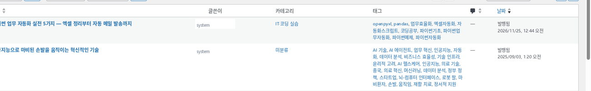

# 05-3. 카테고리와 태그, 대표이미지

## 카테고리는 만들지 않는다

처음 자동 발행을 만들 때 가장 많이 하는 실수입니다. 원고마다 알맞은 카테고리를 새로 만들면, 한 달 뒤 카테고리가 마흔 개가 됩니다. 목록이 길어져 독자가 고르지 못하고, 검색엔진은 사이트 구조를 파악하지 못합니다.

규칙은 하나입니다. 기존 카테고리 중 가장 가까운 것을 고르고, 없으면 기본 카테고리로 보냅니다.

```python
def pick_category(s, candidates, fallback_id):
    cats = s.get(f"{s.base}/wp-json/wp/v2/categories",
                 params={"per_page": 100}).json()
    def norm(x):
        return re.sub(r"[\s·\-_/]", "", x).lower()
    for cand in candidates:
        for c in cats:
            if norm(c["name"]) == norm(cand):
                return c["id"]
    for cand in candidates:
        for c in cats:
            if norm(cand) in norm(c["name"]):
                return c["id"]
    return fallback_id
```text

## 태그는 재사용을 먼저 본다

같은 태그를 매번 새로 만들면 `파이썬`과 `파이썬 `(끝 공백)이 별개로 생깁니다. 이름을 검색해 정확히 일치하는 것이 있으면 그 ID를 씁니다. 대소문자와 공백을 정리한 뒤 비교하십시오.



위 화면은 자동 발행으로 만들어진 글의 목록입니다. 카테고리, 태그, 날짜가 함께 보입니다. 태그 열의 항목이 열 개인지, 카테고리가 의도한 곳인지 이 화면에서 한 번에 확인할 수 있습니다.

## 대표이미지 선택 규칙

| 우선순위 | 조건 |
| --- | --- |
| 1 | 제목 키워드와 파일명이 3개 이상 일치 |
| 2 | 키워드 2개 일치, JPEG |
| 3 | 키워드 1개 일치, 가로 1,200px 이상 |
| 4 | 미리 정한 대체 이미지 |

대표이미지가 글 내용과 무관하면 클릭률은 떨어지지만, 없으면 목록에서 회색 상자가 보입니다. 회색 상자보다는 무관한 사진이 낫습니다. 다만 같은 이미지가 수십 편에 반복되면 목록이 단조로워지므로, 최소 열 장은 준비해 두고 돌려 씁니다.

## 이미지 업로드와 본문 이미지

본문 이미지는 외부 주소를 그대로 씁니다. Pexels 같은 곳의 이미지 주소를 ``의 `src`에 넣으면 사이트에 저장되지 않습니다. 저장되는 것은 대표이미지 하나뿐입니다.

| 종류 | 저장 위치 | 용량 영향 |
| --- | --- | --- |
| 본문 이미지 | 외부 서버 | 없음 |
| 대표이미지 | 사이트 미디어 | 있음 (장당 100~160KB) |

글 한 편의 무게를 1.5MB 이하로 유지하려면 이 구분이 필요합니다.

## 실패 사례: 카테고리 후보가 비었을 때

메타 파일에 카테고리 후보를 적지 않은 원고가 섞여 들어가면, 모든 글이 기본 카테고리에 쌓입니다. 목록이 한 카테고리로만 채워지고 홈 구성이 무너집니다. 발행 스크립트에 "후보가 비어 있으면 경고"를 넣고, 주간 점검에서 카테고리별 글 수를 확인합니다.
