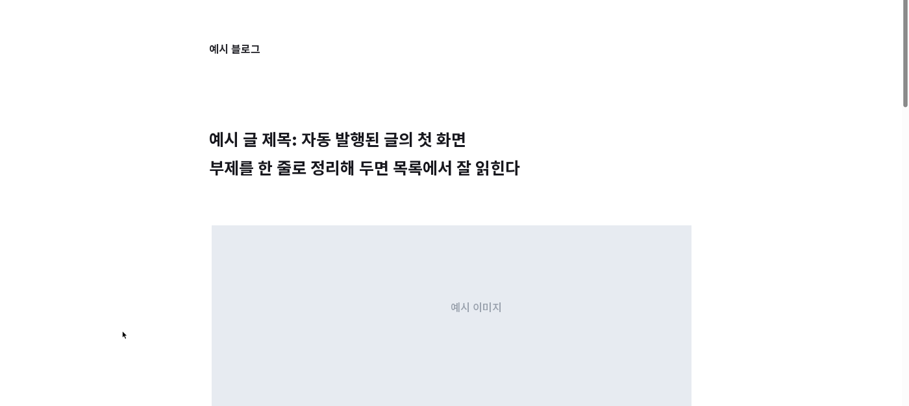

# 05-4. 예약 발행과 재실행

## 같은 글을 두 번 만들지 않는 방법

자동 발행에서 가장 무서운 사고는 중복입니다. 실패한 줄 알고 다시 돌렸는데 앞의 실행이 살아 있었으면, 같은 글이 두 편 올라갑니다. 이런 일이 반복되면 블로그 전체가 중복 문서로 채워집니다.

막는 방법은 하나입니다. 발행 전에 슬러그가 이미 있는지 확인합니다.

```python
def already_exists(s, slug):
    r = s.get(f"{s.base}/wp-json/wp/v2/posts",
              params={"slug": slug, "status": "any"})
    data = r.json()
    return bool(data)
```text

`status=any`가 필요합니다. 공개 글만 검색하면 예약 글이나 임시 글이 걸러지지 않습니다. 이 옵션은 인증된 요청에서만 동작합니다.

발행 함수는 이렇게 시작합니다.

```python
def publish_one(s, item):
    if already_exists(s, item["slug"]):
        return "skip"
    ...
```text

건너뛴 것도 기록에 남깁니다. "이미 있음"과 "실패"는 다르게 취급해야 다음 판단이 가능합니다.

## 재실행 설계

| 상황 | 재실행하면 |
| --- | --- |
| 3번째 글에서 서버 오류 | 1~2번은 건너뛰고 3번부터 |
| 원고 10편 중 7편만 있음 | 있는 것만 발행 |
| 예약 시각을 모두 지남 | 지난 시각은 현재+40분부터 재계산 |
| 사이트 차단(503) | 아무것도 만들지 않고 종료 |

재실행이 안전하면 작업을 작게 나눌 수 있습니다. 열 편을 한 번에 처리하다 실패하면 처음부터 다시 하지 않아도 됩니다.

## 중간 상태 남기기

발행 이력 파일에는 슬러그, 시각, 상태를 남깁니다.

```json
{
  "2026-11-26": [
    {"slug": "python-work-automation-5-examples", "id": 873, "status": "publish"},
    {"slug": "tsmc-2nm-future", "id": 874, "status": "future", "date": "2026-11-26T10:40:00+09:00"}
  ]
}
```text

이 파일은 두 가지에 쓰입니다. 재실행할 때 중복을 막는 것, 그리고 주제 중복을 확인하는 것. 다음 회차에서 원고를 만들기 전에 이 파일의 제목을 읽어, 비슷한 주제가 최근 일주일 안에 있는지 봅니다.

## 발행된 글 확인

예약이 걸린 글이 실제로 공개되었는지 확인하려면 공개 화면을 엽니다. 아래는 8단계의 재조회까지 마친 글의 화면입니다.



제목, 대표이미지, 발행 시각이 모두 의도한 값인지 봅니다. 제목이 원고와 다르면 대개 메타 파일의 제목과 본문 표기가 어긋난 경우입니다. 이때는 글이 이미 발행된 상태이므로, 삭제하지 않고 제목만 수정합니다. 삭제하면 주소가 죽고 검색엔진에 404가 남습니다.

## 예약 시각을 계산할 때 주의

예약 시각은 서버 시간이 아니라 보낸 문자열의 시간대를 기준으로 해석됩니다. `+09:00`을 반드시 붙입니다. 붙이지 않으면 서버 기본 시간대(대개 UTC)로 해석되어 9시간 늦게 발행됩니다.

```python
from datetime import datetime, timezone, timedelta
KST = timezone(timedelta(hours=9))

def iso_kst(dt):
    return dt.astimezone(KST).isoformat(timespec="seconds")
```text

## 오늘 발행분이 예약으로 밀렸을 때

즉시 공개로 보낸 글이 예약 상태로 보이는 경우가 있습니다. 대개 `date`를 함께 보냈기 때문입니다. 공개 글에는 `date`를 넣지 않고 `status`만 `publish`로 둡니다. 이미 예약으로 들어간 글은 관리 화면에서 상태를 바꾸거나, 같은 슬러그로는 다시 만들 수 없으므로 편집 화면에서 직접 공개합니다.
