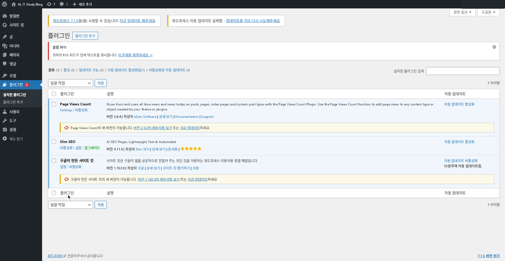
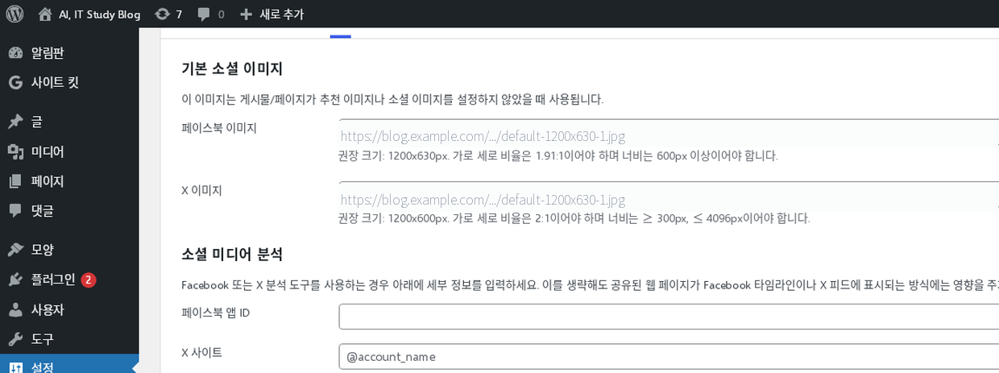

# 05-5. 검색 플러그인 설정 맡기기

## 이 절에서 하는 일

워드프레스에서 검색에 필요한 설정을 플러그인으로 처리합니다. 설정 항목이 많지만, 실제로 손댈 곳은 몇 군데뿐입니다.

## 플러그인으로 정하는 세 가지

| 기능 | 하는 일 | 비슷한 플러그인 |
| --- | --- | --- |
| 제목과 설명 | 검색 결과에 보일 문장을 만듭니다 | 여러 가지가 있습니다 |
| 사이트맵 | 검색엔진에 글 목록을 알립니다 | 대부분 기본 제공 |
| 공유 미리보기 | 링크를 붙였을 때 보일 이미지와 문장 | 대표이미지와 연결 |



플러그인은 많이 깔수록 느려집니다. 검색용 하나, 캐시용 하나, 백업용 하나면 충분합니다. 위 화면처럼 활성화된 플러그인이 몇 개 되지 않는 상태가 관리하기 쉽습니다.

## 이렇게 말하면 됩니다

```
워드프레스 검색 설정을 정리해 줘.
- 검색용 플러그인 하나만 남기고 중복 기능은 끄기
- 글 제목과 설명이 검색 결과에 자연스럽게 나오는지 확인
- 사이트맵 주소를 확인해서 알려 주기
- 공유 미리보기 기본 이미지를 지정
바꾸기 전에 지금 상태를 표로 보여 주고, 내가 고르면 적용해 줘.
```

## 피클이 되묻는 것

| 피클의 질문 | 내가 고르는 답 |
| --- | --- |
| 플러그인이 여러 개인데 무엇을 남길까요 | 검색 기능 하나만 남기기 |
| 기본 설명 문구를 정할까요 | 사이트 성격을 한 줄로 |
| 사이트맵을 검색엔진에 제출할까요 | 제출하고 결과를 알려 주기 |

## 실제 화면



위 화면은 공유 미리보기 이미지를 지정하는 곳입니다. 여기에 이미지를 넣어 두면 글을 공유했을 때 미리보기가 비어 보이지 않습니다. 주소는 자리표시자로 가려 두었습니다.

## 설정을 바꾼 뒤에 확인할 것

| 확인 | 정상 |
| --- | --- |
| 글 하나를 공유했을 때 | 제목, 설명, 이미지가 보임 |
| 사이트맵 주소 | 열리면 정상 |
| 검색 결과 미리보기 | 제목이 잘리지 않음 |

## 잘 안 될 때는 이렇게 말합니다

- "플러그인을 끄니까 사이트가 깨져."라고 하면 방금 끈 플러그인을 다시 켜고 하나씩 확인합니다.
- "검색 결과에 설명이 안 나와."라고 하면 설명 문구가 비어 있는지 확인합니다.
- "사이트맵이 404야."라고 하면 고유주소 설정을 다시 저장해 봅니다.
