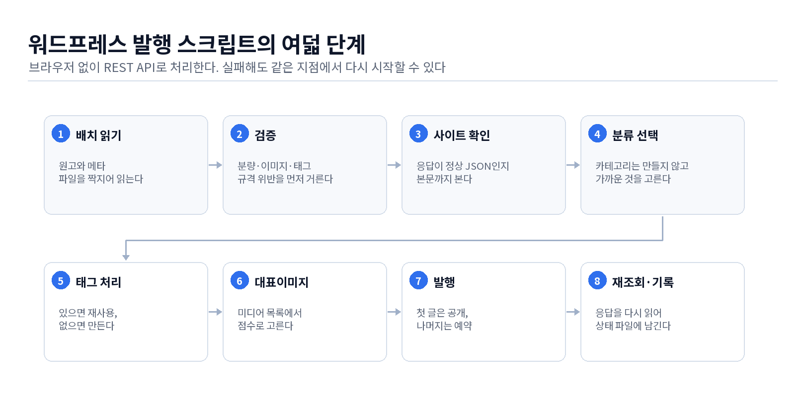

# 05-6. 참고: 발행이 처리되는 과정

이 절은 참고용입니다. 앞의 절까지 따라 하는 데는 필요하지 않습니다. 발행이 어디서 멈추는지 직접 확인하고 싶을 때 읽으십시오.

## 여덟 단계로 나눠 본 발행

워드프레스 자동 발행은 다음 여덟 단계로 이루어집니다. 어느 단계에서 멈추는지 알면 원인을 좁힐 수 있습니다.

| 단계 | 하는 일 | 멈추면 보이는 증상 |
| --- | --- | --- |
| 1 | 인증 확인 | 모든 발행이 실패 |
| 2 | 카테고리와 태그 확인 | 카테고리 없이 발행됨 |
| 3 | 본문 정리 | 문단이 붙어 나옴 |
| 4 | 이미지 준비 | 대표이미지가 비어 있음 |
| 5 | 글 생성 | 목록에 글이 없음 |
| 6 | 대표이미지 지정 | 목록 이미지가 깨짐 |
| 7 | 예약 시각 설정 | 예약 대신 즉시 공개 |
| 8 | 결과 확인 | 성공 여부를 알 수 없음 |

## 어느 단계에서 멈췄는지 찾는 방법

1. 글 목록에 글이 있는지 봅니다. 없으면 5단계 이전입니다.
2. 글이 있는데 대표이미지가 없으면 6단계입니다.
3. 글이 바로 공개되었으면 7단계입니다.
4. 목록에 있는데 사이트에서 안 열리면 캐시나 공개 상태 문제입니다.

이 네 가지만 확인해도 대부분의 원인이 좁혀집니다.

## 참고: 발행 통로의 이름

워드프레스는 프로그램이 글을 넣을 수 있도록 정해진 주소를 제공합니다. 문서에서는 이것을 REST API라고 부릅니다. 주소는 보통 사이트 주소 뒤에 `/wp-json/wp/v2/posts`를 붙인 형태입니다.

- 인증은 앱 비밀번호를 함께 보내는 방식입니다.
- 예약 발행은 글의 상태를 미래 시각으로 지정합니다.
- 이미지 업로드는 별도 주소로 처리합니다.

이 용어를 몰라도 발행은 됩니다. 다만 오류 메시지를 읽어야 할 때는 도움이 됩니다.

## 참고: 발행이 조용히 실패하는 이유

티스토리는 실패하면 화면에 드러나지만, 워드프레스는 응답만 받고 끝나는 경우가 있습니다. 그래서 발행 뒤에 목록을 확인하는 단계가 꼭 필요합니다. 피클에게 늘 결과 확인을 붙여 달라고 말해 두십시오.
