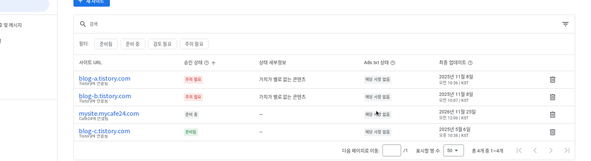

# 06-1. 승인 전에 갖춰야 할 것

## 이 절에서 하는 일

애드센스를 신청하기 전에 사이트가 어떤 상태여야 하는지 확인합니다. 준비 없이 신청하면 대부분 반려되고, 반려 이력이 쌓이면 다음 심사가 더뎌집니다.

## 승인에 필요한 네 가지

| 항목 | 기준 | 확인 방법 |
| --- | --- | --- |
| 글의 양 | 20편 이상, 서로 다른 주제 | 글 목록 개수 |
| 글의 질 | 직접 쓴 흔적이 있는 글 | 도입과 경험이 들어갔는지 |
| 필수 페이지 | 소개, 개인정보처리방침, 문의 | 메뉴에 있는지 |
| 사이트 안정성 | 멈춤 없이 열림 | 하루 여러 번 접속 |



사이트 목록에서 상태를 확인합니다. 준비 중, 검토 중, 준비됨 같은 표시가 보이고, 사이트별로 상세 화면에 들어가면 무엇이 부족한지 나옵니다.

## 이렇게 말하면 됩니다

```
애드센스 신청 전에 내 사이트를 점검해 줘.
- 공개된 글 수와 주제가 얼마나 다양한지
- 소개, 개인정보처리방침, 문의 페이지가 있는지
- 사이트가 오류 없이 열리는지
- 광고 코드를 넣을 자리가 있는지
부족한 항목이 있으면 무엇을 먼저 채워야 하는지 순서대로 알려 줘.
```

## 피클이 되묻는 것

| 피클의 질문 | 내가 고르는 답 |
| --- | --- |
| 애드센스 계정이 이미 있나요 | 있음 / 새로 만들기 중 선택 |
| 사이트가 여러 개인데 모두 신청할까요 | 준비된 곳부터 하나씩 |
| 필수 페이지를 만들까요 | 만들어서 메뉴에 넣기 |

## 내가 직접 하는 일

1. 애드센스 가입 화면에서 국가, 계정 정보, 결제 정보를 입력합니다.
2. 사이트 주소를 넣고 소유 확인 방법을 고릅니다.
3. 심사 요청을 보냅니다.

결제 정보는 사람이 직접 넣는 편이 안전합니다. 이 정보는 한 번 정해지면 바꾸기 어렵습니다.

## 신청 전에 정리할 것

| 정리 대상 | 하는 일 |
| --- | --- |
| 비어 있는 글 | 삭제하거나 내용을 채웁니다 |
| 중복 글 | 하나로 합칩니다 |
| 광고성 글 | 비공개로 돌립니다 |
| 깨진 링크 | 고치거나 지웁니다 |

## 잘 안 될 때는 이렇게 말합니다

- "신청했는데 바로 반려됐어."라고 하면 반려 사유를 읽고 부족한 항목을 채우는 순서를 안내합니다.
- "글은 많은데 승인이 안 나."라고 하면 글의 주제가 한쪽으로 몰려 있는지 확인합니다.
- "필수 페이지를 어떻게 써야 해?"라고 하면 각 페이지에 들어갈 항목을 예시와 함께 알려 줍니다.
