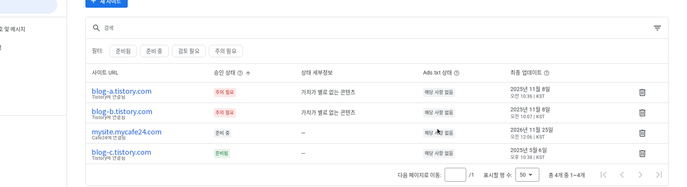

# 06-2. 사이트 연결과 ads.txt

## 사이트 상태 화면 읽기

애드센스의 사이트 목록에는 사이트마다 상태가 표시됩니다.



위 화면에서 읽을 것은 세 열입니다.

| 열 | 읽는 법 |
| --- | --- |
| 승인 상태 | 준비됨, 준비 중, 주의 필요 |
| 상태 세부정보 | 검토 중인지, 콘텐츠 문제인지 |
| ads.txt 상태 | 인증됨, 찾을 수 없음, 해당 사항 없음 |

`준비 중`은 검토 대기입니다. 며칠에서 몇 주 걸립니다. `주의 필요`는 콘텐츠 또는 정책 문제이고, 세부정보 열에 이유가 적힙니다.

## ads.txt

ads.txt는 "이 사이트의 광고는 이 사업자를 통해 판매된다"를 선언하는 텍스트 파일입니다. 없으면 수익이 제한되거나 인증되지 않은 상태로 남습니다.

내용은 애드센스 계정마다 다릅니다. 계정 화면의 ads.txt 안내에서 복사해 사이트 루트에 둡니다.

```text
google.com, pub-0000000000000000, DIRECT, f08c47fec0942fa0
```

| 사이트 | 두는 방법 |
| --- | --- |
| 루트 도메인 워드프레스 | 파일을 루트에 업로드하거나 SEO 플러그인 기능 사용 |
| 티스토리 | 블로그 설정의 ads.txt 항목에 붙여넣기 |
| 호스팅 하위 경로 | 사이트 루트 기준으로 확인 |

업로드 후 `https://내도메인/ads.txt`를 열어 내용이 보이는지 확인합니다. 브라우저에 HTML이 뜨면 경로가 틀린 것입니다.

## 소유 확인 방식

| 방식 | 적용 | 특징 |
| --- | --- | --- |
| 광고 코드 삽입 | 워드프레스, 티스토리 | 가장 확실 |
| ads.txt | 모든 사이트 | 인증에도 사용 |
| 메타 태그 | 워드프레스 | 테마 head에 삽입 |

워드프레스는 Site Kit 같은 도구로 연결하면 소유 확인과 광고 코드 삽입이 함께 됩니다. 다만 도구가 여러 서비스를 동시에 연결하므로, 연결 상태를 하나씩 확인해야 합니다.

## 연결 후 확인

- 사이트 상태가 `준비됨` 또는 `준비 중`인지
- ads.txt가 `인증됨`으로 바뀌었는지
- 사이트에 광고 코드가 실제로 출력되는지 (페이지 소스에서 확인)
- 광고 단위가 자동인지 수동인지

## 자주 생기는 문제

| 증상 | 원인 | 대응 |
| --- | --- | --- |
| ads.txt를 찾을 수 없음 | 경로 오류, 캐시 | 캐시 삭제 후 재확인 |
| 준비 중이 몇 주째 | 검토 대기 | 상태를 바꾸지 말고 대기 |
| 주의 필요 | 콘텐츠 품질 | 06-3 참고 |
| 코드를 넣었는데 광고가 안 보임 | 위치 누락, 승인 전 | 승인 후 자동 광고 활성화 확인 |

승인 전에는 광고가 보이지 않는 것이 정상입니다. 코드가 삽입되었는지는 페이지 소스에서 `adsbygoogle` 문자열로 확인합니다.
