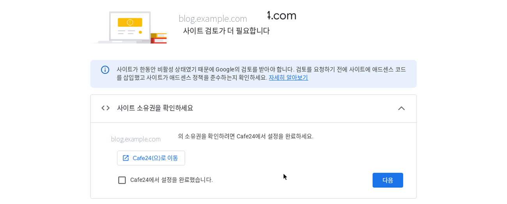

# 06-2. 사이트 연결과 ads.txt

## 이 절에서 하는 일

애드센스에 사이트를 연결하고, 광고가 정상으로 나가기 위한 확인 파일을 둡니다. 이 두 가지가 어긋나면 승인이 나도 광고가 나오지 않습니다.

## 연결 세 단계

| 단계 | 하는 일 | 사람이 하는 부분 |
| --- | --- | --- |
| 1 | 애드센스에 사이트 주소 등록 | 주소 입력 |
| 2 | 소유 확인 | 확인 방법 선택 |
| 3 | 확인 코드 또는 파일 설치 | 피클에게 맡김 |

소유 확인 방법은 여러 가지가 있습니다. 워드프레스는 플러그인으로 자동 연결이 되기도 하고, 티스토리는 대개 코드를 스킨에 넣습니다.

## ads.txt란 무엇인가

광고를 파는 회사를 사이트가 공개적으로 알리는 작은 파일입니다. 이 파일이 없으면 일부 광고가 나가지 않습니다. 사이트 주소 뒤에 `/ads.txt`를 붙여 열리는지 확인하면 됩니다.

| 사이트 | ads.txt 위치 |
| --- | --- |
| 워드프레스 | 사이트 루트 |
| 티스토리 | 관리 화면의 광고 설정 또는 스킨 파일 |
| 호스팅 | 파일 관리자로 업로드 |

## 이렇게 말하면 됩니다

```
애드센스 사이트 연결과 ads.txt를 확인해 줘.
- 내 사이트 주소로 ads.txt가 열리는지
- 열린다면 안에 내 애드센스 게시자 ID가 들어 있는지
- 없으면 어디에 어떻게 넣어야 하는지 알려 주고, 넣은 뒤 다시 확인
- 소유 확인 상태도 함께 알려 줘
```

## 피클이 되묻는 것

| 피클의 질문 | 내가 고르는 답 |
| --- | --- |
| 소유 확인은 어떤 방법으로 할까요 | 사이트 종류에 맞는 방법을 추천받아 선택 |
| ads.txt를 직접 올릴까요 | 호스팅 파일 관리자로 올리기 |
| 다른 사이트도 같이 할까요 | 준비된 사이트부터 |

## 실제 화면



위 화면은 소유권 확인이 남아 있는 상태입니다. 이 화면이 보이면 확인 절차를 마쳐야 심사가 진행됩니다. 주소는 자리표시자로 가려 두었습니다.

## 확인이 끝난 뒤

| 확인 | 정상 |
| --- | --- |
| 사이트 목록의 상태 | 준비됨 또는 검토 중 |
| ads.txt | 주소로 열리고 게시자 ID가 보임 |
| 광고 코드 | 페이지 소스에 들어 있음 |

## 잘 안 될 때는 이렇게 말합니다

- "ads.txt가 안 열려."라고 하면 파일 위치와 이름을 확인합니다. 이름은 소문자여야 합니다.
- "소유 확인이 계속 실패해."라고 하면 확인 코드가 사이트에 실제로 들어갔는지 봅니다.
- "광고 코드를 어디에 넣어야 해?"라고 하면 사이트 종류에 맞는 위치를 알려 줍니다.
