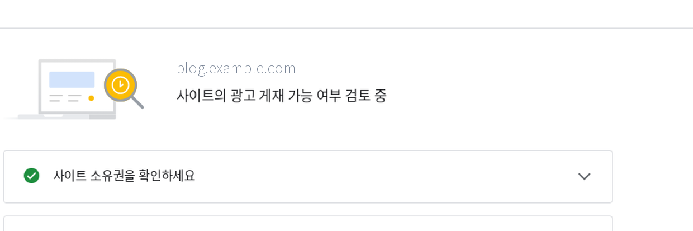

# 06-3. 가치가 낮은 콘텐츠 판정 대응

## 이 절에서 하는 일

애드센스 심사에서 자주 나오는 판정 중 하나가 "가치가 별로 없는 콘텐츠"입니다. 이 판정은 사이트 전체가 아니라 일부 글의 성격 때문에 나오는 경우가 많습니다. 무엇을 고치면 되는지 순서대로 정리합니다.

## 판정이 나오는 이유

| 이유 | 예 | 고치는 방법 |
| --- | --- | --- |
| 같은 형식의 글 반복 | 같은 틀로 만든 글 100편 | 경험과 예시를 섞습니다 |
| 정보가 얕음 | 제목만 있고 내용이 짧음 | 분량과 근거를 보강합니다 |
| 원문이 없는 요약 | 다른 글을 옮긴 글 | 직접 확인한 내용을 넣습니다 |
| 광고성 글 | 링크만 나열 | 제휴 비중을 줄입니다 |
| 오래 방치 | 몇 달째 새 글이 없음 | 발행을 다시 시작합니다 |

애드센스 안내에는 색인이 승인 조건으로 적혀 있지 않습니다. 그래도 색인이 거의 없는 사이트는 심사에 필요한 근거(방문이 있는 페이지, 크롤러가 읽은 글)가 함께 부족한 경우가 많아, 색인 상태를 먼저 보는 편이 빠릅니다. 두 일이 어떻게 이어지는지는 07-5에서 따로 다룹니다.



위 화면은 심사를 요청해 둔 상태입니다. 이 상태에서는 사이트를 크게 고치지 않는 편이 좋습니다. 심사 중에 구조를 바꾸면 다시 처음부터 볼 수 있습니다.

## 이렇게 말하면 됩니다

```
애드센스에서 가치가 낮은 콘텐츠라는 판정을 받았어. 내 사이트 글을 보고 원인을 정리해 줘.
- 같은 형식이 반복되는 글
- 분량이 짧거나 정보가 얕은 글
- 링크만 많은 글
고칠 순서를 정해서 알려 주고, 내가 승인하면 고친 뒤 재검토를 요청해 줘.
```

## 피클이 되묻는 것

| 피클의 질문 | 내가 고르는 답 |
| --- | --- |
| 문제 글을 비공개로 돌릴까요, 고칠까요 | 살릴 글은 고치고, 못 살릴 글은 비공개 |
| 재검토를 언제 요청할까요 | 수정이 끝난 뒤 한 번만 |
| 새 글 발행은 계속할까요 | 계속하되 품질 기준을 올림 |

## 고치는 순서

1. 문제 글 목록을 만듭니다. 판정 화면에는 대개 예시가 나옵니다.
2. 살릴 글과 내릴 글을 나눕니다.
3. 살릴 글은 도입, 경험, 예시를 더합니다.
4. 내릴 글은 비공개로 돌립니다.
5. 필수 페이지를 보강합니다.
6. 재검토를 요청합니다.

## 재검토를 요청하는 문장

```
수정이 끝났어. 재검토를 요청해 줘. 요청 전에 사이트가 정상으로 열리는지, 문제 글이 비공개로 바뀌었는지 확인해서 알려 줘.
```

## 잘 안 될 때는 이렇게 말합니다

- "재검토를 여러 번 했는데 계속 반려야."라고 하면 사이트 전체의 글 비중을 다시 봅니다.
- "글을 지우면 승인에 불리한가요?"라고 하면 삭제보다 비공개가 안전하다고 안내합니다.
- "언제 다시 신청하면 좋을까?"라고 하면 수정 범위와 발행 상태를 보고 시점을 제안합니다.
