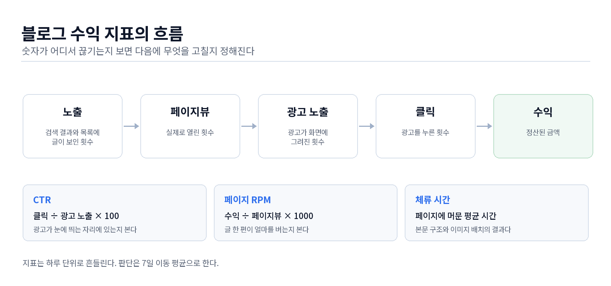

# 06-4. 광고 배치와 지표 읽기

## 이 절에서 하는 일

승인 뒤에 광고를 어디에 두고, 어떤 숫자를 보면 되는지 정리합니다. 처음 한 달은 숫자가 거의 움직이지 않습니다. 그래서 무엇을 기준으로 판단할지 미리 정해 두는 편이 좋습니다.

## 광고를 두는 자리

| 자리 | 장점 | 주의 |
| --- | --- | --- |
| 본문 상단 | 눈에 잘 띕니다 | 너무 위면 이탈이 늘어납니다 |
| 본문 중간 | 읽는 흐름을 끊지 않습니다 | 문단 사이에만 넣습니다 |
| 본문 하단 | 읽고 난 뒤 노출됩니다 | 수익 기여는 작습니다 |
| 사이드바 | 여러 글에서 반복 노출 | 모바일에서는 보이지 않습니다 |

처음에는 본문 중간 한 곳과 하단 한 곳이면 충분합니다. 광고가 많아지면 읽기 어려워지고, 읽는 시간이 줄면 수익도 줄어듭니다.

## 이렇게 말하면 됩니다

```
내 블로그 광고 배치를 정리해 줘.
- 본문 중간 한 곳과 하단 한 곳만 남기기
- 문단 사이에 자연스럽게 들어가게
- 모바일에서 광고가 화면을 덮지 않는지 확인
바꾼 뒤에는 어떤 글에 어떤 광고가 들어갔는지 표로 알려 줘.
```

## 피클이 되묻는 것

| 피클의 질문 | 내가 고르는 답 |
| --- | --- |
| 자동 광고를 쓸까요, 직접 배치할까요 | 처음에는 자동, 이후 직접 |
| 광고를 줄일까요 | 읽기 불편하면 줄이기 |
| 지표를 매일 볼까요 | 주 1회 표로 받기 |

## 지표를 읽는 순서

| 지표 | 뜻 | 먼저 볼 이유 |
| --- | --- | --- |
| 노출수 | 광고가 보인 횟수 | 글이 검색에 노출되는지 알 수 있습니다 |
| 클릭률 | 노출 대비 클릭 비율 | 광고 위치가 적절한지 알 수 있습니다 |
| 페이지 RPM | 1,000회 조회당 수익 | 사이트 수익성을 비교할 수 있습니다 |
| 예상 수익 | 그날의 수익 | 추세를 보는 용도입니다 |



## 처음 한 달에 기대할 것

- 노출수는 발행량에 거의 비례합니다. 글이 늘면 노출도 늘어납니다.
- 클릭률은 1% 안팎이 흔합니다. 그보다 높으면 광고 위치가 강한 것입니다.
- 예상 수익은 하루 몇십 원 수준에서 시작합니다. 이 숫자만 보고 판단하지 마십시오.

## 잘 안 될 때는 이렇게 말합니다

- "광고가 아예 안 보여."라고 하면 승인 상태와 코드 설치를 확인합니다.
- "수익이 갑자기 0이 됐어."라고 하면 정책 위반 알림이 있는지 확인합니다.
- "광고 때문에 글이 안 읽혀."라고 하면 광고 수를 줄이고 위치를 옮깁니다.
