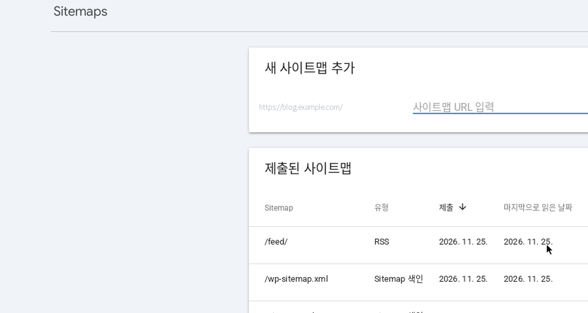

# 07-1. 구글 서치콘솔 등록

## 이 절에서 하는 일

구글 서치콘솔에 사이트를 등록하고 사이트맵을 제출합니다. 구글은 검색 유입의 큰 부분을 차지하므로 가장 먼저 하는 편이 좋습니다.

## 순서

1. 서치콘솔에 구글 계정으로 로그인합니다. 애드센스와 같은 계정을 쓰면 관리가 편합니다.
2. 속성 추가에서 사이트 주소를 넣습니다. 도메인 방식과 주소 접두어 방식이 있는데, 처음에는 주소 접두어가 쉽습니다.
3. 소유 확인을 합니다. 워드프레스는 플러그인, 티스토리는 코드나 파일, 호스팅은 DNS 기록을 씁니다.
4. 사이트맵을 제출합니다.

## 이렇게 말하면 됩니다

```
구글 서치콘솔에 내 사이트를 등록하고 사이트맵을 제출해 줘.
- 소유 확인은 사이트 종류에 맞는 방법으로
- 사이트맵 주소를 찾아서 제출
- 확인이 끝나면 상태를 표로 보고
사람이 직접 눌러야 하는 단계가 있으면 미리 알려 줘.
```

## 피클이 되묻는 것

| 피클의 질문 | 내가 고르는 답 |
| --- | --- |
| 속성 방식은 무엇으로 할까요 | 주소 접두어 |
| 소유 확인은 어떻게 할까요 | 사이트 종류에 맞는 방법 추천 |
| 사이트맵 주소를 아나요 | 자동으로 찾아보게 함 |

## 실제 화면



위 화면에서 새 사이트맵을 추가하고 상태를 확인합니다. 성공으로 표시되면 제출이 끝난 것입니다. 주소는 자리표시자로 가려 두었습니다.

## 제출할 사이트맵

| 사이트 | 사이트맵 주소의 예 |
| --- | --- |
| 워드프레스 | `https://blog.example.com/wp-sitemap.xml` |
| 티스토리 | `https://blog-a.tistory.com/sitemap.xml` |
| RSS | `https://blog.example.com/feed/` |

사이트맵이 여러 개면 모두 제출합니다. RSS도 검색엔진이 새 글을 빨리 발견하는 데 도움이 됩니다.

## 등록 뒤에 확인할 것

| 확인 | 정상 |
| --- | --- |
| 속성 상태 | 소유 확인됨 |
| 사이트맵 | 성공 |
| 색인 생성 | 며칠 안에 숫자가 늘어남 |

## 잘 안 될 때는 이렇게 말합니다

- "소유 확인이 안 돼."라고 하면 확인 코드가 실제 페이지에 들어갔는지 확인합니다.
- "사이트맵이 읽히지 않아."라고 하면 주소를 직접 열어 형식이 맞는지 봅니다.
- "색인이 0이야."라고 하면 사이트 공개 설정과 등록 상태를 확인합니다.
