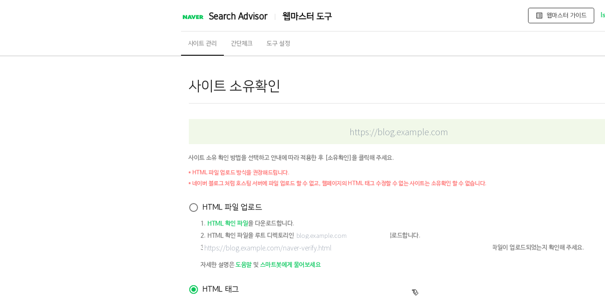

# 07-2. 네이버 서치어드바이저 소유확인

## 이 절에서 하는 일

네이버 서치어드바이저에 사이트를 등록합니다. 네이버는 소유 확인 과정에 보안문자가 자주 나오기 때문에, 사람이 직접 처리해야 하는 부분이 있습니다.

## 순서

1. 서치어드바이저에 네이버 계정으로 로그인합니다.
2. 사이트 등록에서 주소를 넣습니다.
3. 소유 확인 방법을 고릅니다. HTML 태그, HTML 파일 업로드, DNS 중에서 사이트에 맞는 것을 고릅니다.
4. 확인을 누릅니다. 보안문자가 나오면 직접 입력합니다.
5. 사이트맵과 RSS를 제출합니다.



위 화면에서 확인 방법을 고르고 소유확인을 누릅니다. HTML 파일 업로드를 고르면 파일을 사이트 루트에 올려야 하고, HTML 태그를 고르면 사이트 머리에 태그를 넣어야 합니다.

## 어떤 방법을 고를까

| 사이트 | 쉬운 방법 | 비고 |
| --- | --- | --- |
| 워드프레스 | HTML 태그 | 검색 플러그인에 넣는 칸이 있습니다 |
| 티스토리 | HTML 태그 | 스킨 편집의 head에 넣습니다 |
| 호스팅 직접 운영 | HTML 파일 업로드 | 파일을 루트에 올립니다 |

## 이렇게 말하면 됩니다

```
네이버 서치어드바이저에 내 사이트를 등록해 줘.
- 소유 확인은 사이트 종류에 맞는 방법으로 준비
- 태그나 파일을 넣을 위치까지 알려 주고, 내가 승인하면 적용
- 보안문자가 나오면 화면을 띄워서 나에게 넘겨 줘
- 확인이 끝나면 사이트맵과 RSS를 제출하고 결과를 보고
```

## 피클이 되묻는 것

| 피클의 질문 | 내가 고르는 답 |
| --- | --- |
| 소유 확인 방법은 무엇으로 할까요 | 사이트에 맞는 방법 추천 |
| 태그를 넣어도 될까요 | 승인 후 적용 |
| 보안문자가 나왔습니다 | 화면에서 직접 입력하고 완료라고 답장 |

## 보안문자를 만났을 때

네이버는 소유 확인이나 사이트맵 제출에서 보안문자를 자주 띄웁니다. 이때는 피클이 화면을 띄워 주고, 사용자가 직접 입력합니다.

1. 피클이 원격 화면을 엽니다.
2. 화면의 보안문자를 보고 입력합니다.
3. 제출을 누릅니다.
4. 채팅에 "완료"라고 답장합니다.

보안문자를 여러 번 틀리면 잠시 막힙니다. 확실하지 않으면 새로 고침해서 다른 문제를 받는 편이 낫습니다.

## 확인이 끝난 뒤

| 확인 | 정상 |
| --- | --- |
| 사이트 목록 | 사이트가 등록됨 |
| 소유 확인 | 확인됨 |
| 사이트맵 | 제출됨 |
| 수집 요청 | 새 글 주소를 요청할 수 있음 |

## 잘 안 될 때는 이렇게 말합니다

- "소유 확인이 안 돼."라고 하면 태그가 실제 페이지 소스에 있는지 확인합니다.
- "보안문자가 계속 나와."라고 하면 잠시 뒤에 다시 시도하도록 안내합니다.
- "사이트맵이 거부됐어."라고 하면 주소 형식과 접근 가능 여부를 확인합니다.
