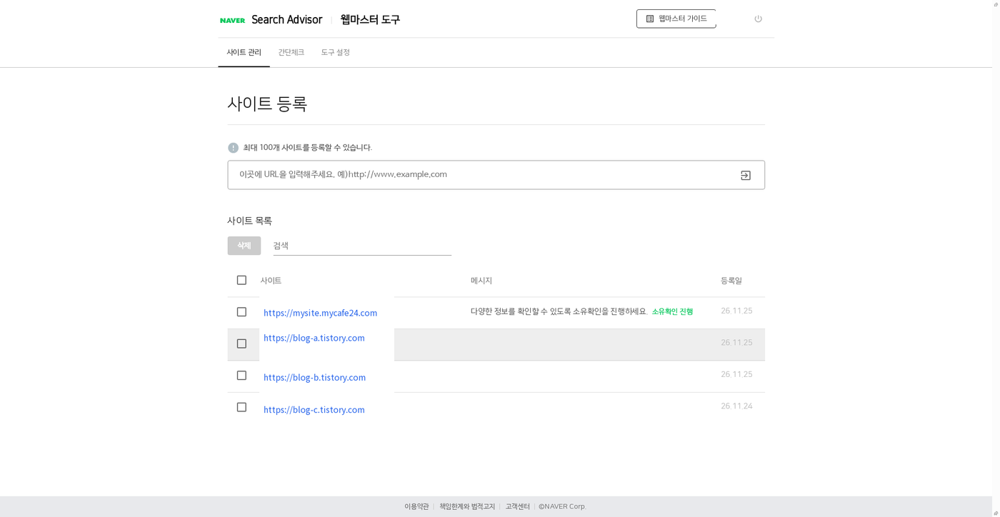

# 07-2. 네이버 서치어드바이저

네이버는 국내 블로그 유입에서 여전히 큰 비중을 차지합니다. 티스토리는 네이버 검색에 비교적 잘 노출되지만, 등록하지 않으면 색인 상태를 알 수 없고 사이트맵·RSS 제출도 할 수 없습니다.

## 사이트 추가

1. `searchadvisor.naver.com`에 접속해 네이버 계정으로 로그인합니다.
2. 웹마스터 도구에서 사이트를 추가합니다. 주소를 입력하면 소유 확인 단계로 넘어갑니다.
3. 소유 확인 방식을 고릅니다.

| 방식 | 적용 | 비고 |
| --- | --- | --- |
| HTML 태그 | 블로그 head에 메타 태그 | 가장 간단 |
| HTML 파일 | 사이트 루트에 업로드 | 워드프레스에 적합 |
| DNS | 도메인 소유 | 도메인 있을 때 |

티스토리는 블로그 설정에 메타 태그를 넣는 항목이 있습니다. 발급받은 태그를 그대로 붙여 넣고 저장한 뒤 확인 버튼을 누릅니다. 이미 블로그에 태그가 들어 있는 경우 저장만으로 통과합니다.

## RSS와 사이트맵 제출

소유 확인이 끝나면 요청 메뉴에서 RSS와 사이트맵을 제출합니다.

| 항목 | 주소 |
| --- | --- |
| RSS | `https://내블로그.tistory.com/rss` |
| 사이트맵 | `https://내블로그.tistory.com/sitemap.xml` |

이 단계에서 수집 요청이 캡차로 막히는 경우가 있습니다. 캡차는 사람이 풀어야 하므로, 자동화로 넘기지 말고 직접 처리합니다. 실패해도 소유 확인은 이미 끝난 상태이므로, RSS 제출은 나중에 다시 시도하면 됩니다.

## 화면에서 읽을 것

| 항목 | 의미 |
| --- | --- |
| 등록일 | 사이트가 등록된 날짜 |
| 수집 요청 | RSS·사이트맵 제출 상태 |
| 콘텐츠 노출 | 검색에 노출되는 페이지 수 |
| 검색 유입 | 어떤 검색어로 들어왔는지 |

네이버는 구글보다 색인 반영이 느린 편입니다. 새 글이 며칠 안에 노출되지 않아도 정상입니다. 대신 한 번 노출되면 오래 유지되는 경향이 있습니다.

## 티스토리와 다음의 관계

티스토리 블로그는 다음 검색에 자동으로 노출됩니다. 별도 등록이 필요하지 않고, 등록을 시도하면 심사만 늘어납니다. 이 사실을 모르고 등록 창에서 시간을 쓰는 경우가 많습니다. 다음 장에서 예외 상황만 정리합니다.

## 워드프레스에서 주의할 점

워드프레스는 메타 태그를 테마 head에 직접 넣어야 합니다. 파일 쓰기 권한이 없으면 세 가지 방법이 있습니다.

1. 테마의 함수 파일에 코드를 추가한다.
2. 소유 확인 HTML 파일을 루트에 업로드한다.
3. SEO 플러그인의 확인 코드 항목을 사용한다.

1번은 테마 업데이트 때 사라질 수 있습니다. 3번이 가장 안전합니다.

## 확인 주기

| 주기 | 확인 |
| --- | --- |
| 주 1회 | 검색 유입 검색어 상위 10개 |
| 월 1회 | 콘텐츠 노출 수 변화 |
| 분기 1회 | 소유 확인 유지 여부 |

소유 확인은 주기적으로 다시 요구될 수 있습니다. 메타 태그를 지우거나 테마를 바꾸면 확인이 풀리고, 그때부터 색인 정보가 갱신되지 않습니다.
