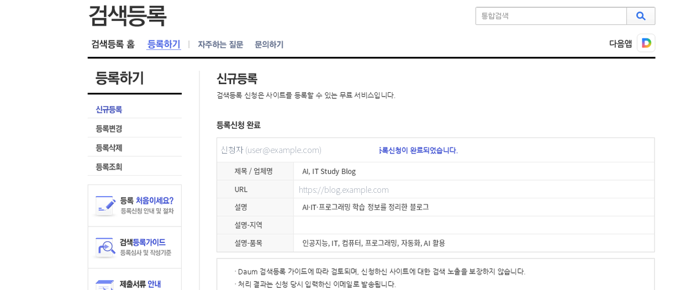

# 07-3. 다음 검색등록

## 이 절에서 하는 일

다음 검색에 사이트를 등록합니다. 다음은 티스토리 블로그를 자동으로 수집하는 경우가 많아, 따로 신청하지 않아도 노출되는 일이 있습니다. 다만 직접 운영하는 사이트는 신청이 필요합니다.

## 순서

1. 다음 검색등록 페이지에서 등록 신청을 엽니다.
2. 사이트 주소와 운영자 정보를 입력합니다.
3. 수집 주소를 확인하고 신청합니다.
4. 접수 결과를 확인합니다.



위 화면은 신청이 접수된 상태입니다. 신청자 정보와 주소는 자리표시자로 가려 두었습니다.

## 이렇게 말하면 됩니다

```
다음 검색등록에 내 사이트를 신청해 줘.
- 사이트 주소와 수집 주소 확인
- 신청서에 들어갈 내용을 미리 보여 주고, 내가 승인하면 제출
- 접수 결과와 함께, 반영까지 얼마나 걸리는지 알려 줘
```

## 피클이 되묻는 것

| 피클의 질문 | 내가 고르는 답 |
| --- | --- |
| 운영자 이름을 넣어도 될까요 | 공개해도 되는 이름이나 사이트명으로 |
| RSS도 등록할까요 | 함께 등록 |
| 사이트가 접속 불가로 나오면 | 잠시 뒤 다시 신청 |

## 신청할 때 넣는 정보

| 항목 | 내용 |
| --- | --- |
| 사이트 주소 | 대표 주소 하나 |
| 수집 주소 | 사이트맵 또는 RSS |
| 사이트 이름 | 검색에 보일 이름 |
| 운영자 | 공개 가능한 이름이나 사이트명 |

## 다음에서 자주 겪는 일

- 신청 직후에는 반영되지 않습니다. 며칠에서 몇 주가 걸릴 수 있습니다.
- 사이트가 잠시 접속 불가였을 때 신청하면 보류됩니다. 사이트가 정상으로 열린 뒤 다시 신청합니다.
- 티스토리는 이미 수집된 경우가 있어, 신청하지 않아도 노출됩니다.

## 확인하는 방법

검색창에 사이트 주소를 넣어 보고, `site:내주소` 형태로 검색해 봅니다. 결과가 나오면 수집된 것입니다.

## 잘 안 될 때는 이렇게 말합니다

- "신청했는데 접속 불가로 나와."라고 하면 사이트가 실제로 열리는지 확인하고 다시 신청합니다.
- "반영이 안 돼."라고 하면 수집 요청을 다시 보내고 기다립니다.
- "티스토리도 신청해야 해?"라고 하면 이미 수집되는지 먼저 확인하도록 안내합니다.
