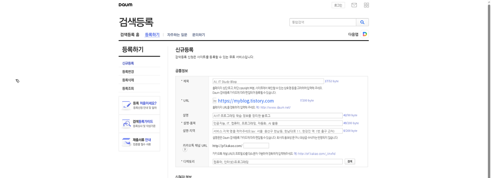

# 07-3. 다음 검색등록

다음 검색 등록은 `register.search.daum.net`에서 합니다. 등록할 수 있는 대상은 사이트, 블로그, 카페 등이고, 심사 후 노출됩니다.



## 먼저 확인할 것

티스토리 블로그라면 등록이 필요하지 않습니다. 다음 검색은 티스토리 블로그를 자동으로 수집합니다. 등록을 시도하면 심사 대기만 늘어나고, 실제 노출은 이미 되고 있는 경우가 많습니다.

등록이 필요한 경우는 다음과 같습니다.

- 자체 도메인을 쓰는 워드프레스
- 새로 만든 도메인이 다음 검색에 전혀 나오지 않을 때
- 수집이 오래 멈춰 있을 때

## 신청서 작성

| 항목 | 적을 값 |
| --- | --- |
| 제목 | 사이트 이름 |
| URL | 사이트 주소 |
| 설명 | 사이트 성격을 두 문장으로 |
| 선택 분류 | 주제에 맞는 분류 두 개 |
| 선택 지역 | 지역 사이트일 때만 |
| 디렉터리 | 해당하면 선택 |

설명은 검색 결과에 그대로 노출될 수 있습니다. 인사말보다 사이트가 무엇을 제공하는지 쓰는 편이 좋습니다.

## 자주 막히는 지점

| 상황 | 원인 | 대응 |
| --- | --- | --- |
| 접속 불가로 신청 실패 | 사이트 응답 오류(503 등) | 사이트가 정상 응답할 때 다시 |
| 심사 반려 | 콘텐츠 부족 | 글을 늘리고 다시 |
| 등록했는데 안 나옴 | 색인 반영 시간 | 2~4주 대기 |
| 이미 등록됨 | 자동 수집 | 그대로 둠 |

첫 번째가 실제로 자주 발생합니다. 사이트가 트래픽 초과로 503을 내는 시간에 신청하면, 신청서는 접수되지 않고 오류로 끝납니다. 신청 전에 사이트가 정상 응답하는지 먼저 확인합니다.

```bash
curl -s -o /dev/null -w "%{http_code}\n" https://내도메인/
```

200이 나오면 신청하고, 503이나 500이면 복구 후에 신청합니다.

## 등록 후 확인

- 검색창에 `site:내도메인`을 넣어 노출되는 페이지 수를 확인합니다.
- 한 달에 한 번 정도 확인하면 충분합니다.
- 노출 수가 줄었으면 색인 상태를 서치콘솔에서 다시 봅니다.

## 세 엔진을 함께 볼 때

| 엔진 | 새 글 반영 | 유지 기간 |
| --- | --- | --- |
| 구글 | 수일 | 길다 |
| 네이버 | 수일~2주 | 길다 |
| 다음 | 수일 | 중간 |

세 엔진의 반영 속도가 다르므로, 하루 이틀 노출이 없다고 문제로 판단하지 않습니다. 2주가 지나도 노출이 없으면 그때 색인과 사이트맵을 확인합니다.
