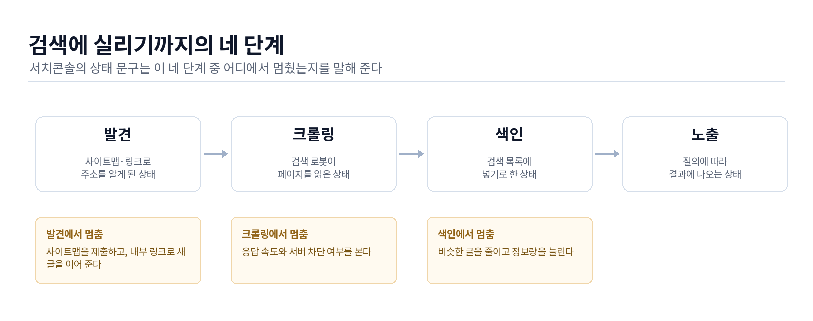

# 07-4. 색인 상태 읽기

## 이 절에서 하는 일

검색엔진이 내 글을 얼마나 알고 있는지 확인하는 방법을 정리합니다. 색인은 등록과 다릅니다. 등록은 사이트를 알린 것이고, 색인은 글이 검색 결과에 들어간 것입니다.

## 무엇을 보면 되는가

| 지표 | 어디서 | 뜻 |
| --- | --- | --- |
| 색인된 페이지 수 | 서치콘솔 > 페이지 | 검색에 들어간 글 수 |
| 수집됨·색인 안 됨 | 서치콘솔 > 페이지 | 읽었지만 넣지 않은 이유 |
| 사이트맵 상태 | 서치콘솔 > 사이트맵 | 제출이 처리됐는지 |
| 수집 요청 | 네이버 > 수집 요청 | 새 글을 빨리 읽게 함 |
| 검색 노출 수 | 네이버 > 리포트 | 실제로 보인 횟수 |



## 색인이 안 되는 흔한 이유

| 이유 | 확인 | 대응 |
| --- | --- | --- |
| 글 수가 적음 | 사이트맵의 URL 수 | 발행을 이어감 |
| 내용이 비슷함 | 비슷한 제목의 글 | 주제를 나눔 |
| 접속 오류 | 사이트 상태 | 호스팅과 도메인 확인 |
| 공개 설정 | 글의 공개 상태 | 공개로 바꿈 |
| 너무 최근 | 발행 시각 | 며칠 기다림 |

## 이렇게 말하면 됩니다

```
검색 색인 상태를 확인해 줘.
- 구글과 네이버에서 색인된 페이지 수
- 색인이 안 된 이유 중 고칠 수 있는 것
- 사이트맵이 정상으로 처리되는지
- 오늘 새로 발행한 글이 수집 대상인지
표로 정리하고, 내가 고칠 수 있는 것만 알려 줘.
```

## 피클이 되묻는 것

| 피클의 질문 | 내가 고르는 답 |
| --- | --- |
| 수집 요청을 보낼까요 | 새 글 위주로 보내기 |
| 오래된 글도 정리할까요 | 색인에서 빠진 글만 확인 |
| 보고는 얼마나 자주 받을까요 | 주 1회 |

## 숫자를 읽는 요령

- 색인 수는 발행량보다 늦게 움직입니다. 일주일 단위로 보십시오.
- 색인이 안 된 페이지가 늘어나면 내용이 비슷한 글이 많은지 확인합니다.
- 노출은 있는데 클릭이 없으면 제목과 설명을 손봅니다.

## 잘 안 될 때는 이렇게 말합니다

- "색인이 하나도 안 돼."라고 하면 사이트 공개 설정과 사이트맵을 확인합니다.
- "색인은 되는데 노출이 없어."라고 하면 제목과 설명을 다시 씁니다.
- "갑자기 색인이 줄었어."라고 하면 사이트 오류나 정책 위반이 있었는지 봅니다.
