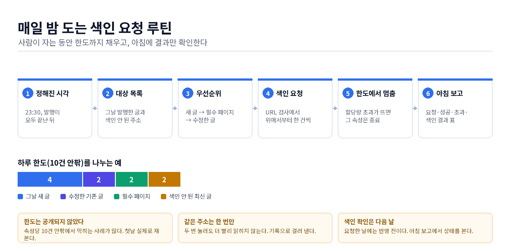

# 07-7. 매일 밤 색인 요청 루틴 만들기

## 이 절에서 하는 일

색인 요청은 하루 10건 안팎입니다. 하루 10편씩 세 곳에 발행하면 그날 새 글만 30편이라 손으로는 따라갈 수 없습니다. 이 절에서는 매일 밤 정해진 시각에 한도까지 채우고, 아침에 결과만 받는 루틴을 만듭니다. 등록은 한 번, 그 뒤로는 사람이 개입하지 않습니다.

## 왜 밤에 돌리는가

| 이유 | 설명 |
| --- | --- |
| 발행이 끝난 뒤 | 그날 올라온 글을 한 번에 대상으로 잡을 수 있다 |
| 한도가 돌아오는 시간 | 자정 초기화는 안내되지 않지만 24시간이 지나야 다시 되는 사례가 많다 |
| 실패해도 손해가 적다 | 아침에 목록을 보고 그날 밤 다시 잡으면 된다 |
| 기록이 남는다 | 어느 주소를 언제 요청했는지 남아 중복 요청을 막는다 |

발행 루틴(09-1)이 끝난 뒤에 돌리는 것이 핵심입니다. 발행 전에 돌리면 그날 글이 대상에서 빠집니다.

## 루틴의 구조



그림의 여섯 단계를 순서대로 옮기면 다음과 같습니다.

1. 23:30에 정기 실행이 시작됩니다.
2. 블로그 속성마다 그날 발행한 글 목록을 확인합니다.
3. 색인 안 된 주소를 우선순위로 정렬합니다. 새 글, 필수 페이지, 수정한 글 순서입니다.
4. URL 검사 화면에서 위에서부터 한 건씩 요청합니다.
5. "할당량 초과"가 뜨면 그 속성은 멈추고 다음 속성으로 넘어갑니다.
6. 결과를 표로 남기고 아침에 보고합니다.

## 이렇게 말하면 됩니다

```
매일 밤 11시 30분에 색인 요청 루틴이 돌게 등록해 줘.
- 대상은 내 블로그 세 곳, 속성마다 따로
- 그날 발행한 글을 먼저, 남는 한도는 필수 페이지와 색인 안 된 최신 글로
- 속성당 10건을 넘기지 말고, 할당량 초과가 뜨면 그 속성은 바로 멈춰
- 이미 요청한 주소는 다시 누르지 말고 기록에서 걸러 줘
- 실패한 주소는 다음 날 목록 맨 앞에 두고, 같은 날 재시도는 하지 마
- 다음 날 아침에 속성별 요청 건수, 성공, 초과, 색인 확인 결과를 표로 보고해 줘
```

## 피클이 되묻는 것

| 피클의 질문 | 내가 고르는 답 |
| --- | --- |
| 시각은 몇 시로 할까요 | 23:30, 발행이 모두 끝난 뒤 |
| 하루 몇 건까지 할까요 | 속성당 10건, 첫날 실제 한도를 재서 조정 |
| 실패하면 다시 시도할까요 | 같은 날은 하지 않고 다음 날 목록에 남김 |
| 보고는 언제 받을까요 | 다음 날 아침 첫 대화에 표로 |
| 발행이 밀린 날은 어떻게 할까요 | 그날 밤 것은 건너뛰고 다음 날로 넘김 |

## 첫 회차에 하는 일: 한도 재기

피클은 첫 회차에서 한도까지 요청해 보고 "할당량 초과"가 뜨는 지점을 기록합니다. 그 수가 그 블로그의 실제 한도입니다. 블로그가 세 곳이면 두 번째 속성에서도 요청이 되는지 확인해, 한도가 속성 단위인지 계정 단위인지 판단합니다. 이 결과를 루틴의 건수로 되돌려 넣으면 다음 날부터 초과로 멈추는 일이 줄어듭니다.

## 등록을 마치면 오는 카드

| 카드에 보이는 것 | 내가 확인할 것 |
| --- | --- |
| 실행 시각 | 23:30, 발행 루틴보다 뒤인지 |
| 대상 속성 | 블로그 세 곳이 모두 들어 있는지 |
| 속성당 최대 건수 | 10건 이하인지 |
| 중복 제외 기준 | 요청 기록을 쓰는지 |

네 가지가 맞으면 승인합니다. 이후로는 등록 카드가 다시 오지 않고, 아침 보고만 남습니다.

## 아침에 받는 보고

| 블로그 | 요청 | 성공 | 초과 | 색인 확인 |
| --- | --- | --- | --- | --- |
| blog.example.com | 10 | 10 | 0 | 6건 색인됨 |
| myblog.tistory.com | 4 | 4 | 0 | 2건 색인됨 |
| shop.example.com | 0 | 0 | 1 | 어제 요청분 3건 색인됨 |

표를 읽는 요령은 네 가지입니다.

- 요청이 0인데 초과가 1이면, 앞선 요청이 아직 한도에 걸려 있다는 뜻입니다. 실행 시각을 30분 뒤로 미룹니다.
- 요청은 성공인데 색인 확인이 0이면, 다음 날 다시 봅니다. 반영은 하루 이를 걸립니다.
- 색인 확인이 계속 0이면 요청을 늘리지 말고 07-4의 사유를 봅니다.
- 실패가 반복되는 주소는 목록에서 빼고 원인을 먼저 확인합니다.

## 한도 안에서 최대한 쓰는 요령

1. 발행 편수를 한도에 맞춥니다. 하루 30편을 올리면 색인 요청은 그중 10편입니다. 나머지는 사이트맵과 내부 링크로 발견되게 합니다.
2. 발행 직후 첫 편만 손으로 요청하고, 나머지는 밤 루틴에 맡깁니다. 첫 편은 그날의 대표 글입니다.
3. 같은 주소를 두 번 요청하지 않습니다. 기록으로 걸러야 한도를 낭비하지 않습니다.
4. 요청만 하고 내용을 그대로 두면 색인은 되지 않습니다. "크롤링됨"에서 멈춘 글이 쌓이면 글을 고치는 일이 먼저입니다.
5. 색인 확인은 요청 다음 날 이후에 합니다. 같은 날 확인하면 아직 반영 전입니다.

## 지켜야 할 선

- 한도 안에서만, 승인한 범위 안에서만 누릅니다. 같은 주소를 반복해 누르는 동작은 비정상 접근으로 보일 수 있고, 계정에 불리합니다.
- 공개 페이지에만 요청합니다. 비공개로 돌릴 글과 삭제할 글은 대상에서 뺍니다.
- 결과가 나쁘다고 루틴을 여러 번 돌리지 않습니다. 하루 한 번이 원칙입니다.
- 색인 수가 늘지 않는 원인은 대개 콘텐츠에 있습니다. 요청 횟수를 늘리는 것으로는 해결되지 않습니다.

## 잘 안 될 때는 이렇게 말합니다

- "루틴이 밤에 안 돌았어."라고 하면 정기 실행 기록과 로그인 세션 만료 여부를 확인합니다.
- "아침 보고가 비어 있어."라고 하면 그날 발행한 글이 있었는지, 사이트맵이 갱신됐는지 확인합니다.
- "매일 초과만 떠."라고 하면 건수를 줄이고 속성 순서를 바꿉니다.
- "색인 수가 안 늘어."라고 하면 요청 건수가 아니라 색인 생성 안 됨 사유를 봅니다.

## 핵심 체크리스트

- [ ] 색인은 승인 조건표에 없지만, 심사가 보는 것과 같은 원인에서 갈린다는 것을 안다.
- [ ] 사이트맵 제출과 색인 요청이 하는 일이 다르다는 것을 안다.
- [ ] 색인 요청은 하루 10건 안팎이고, 같은 주소를 반복해도 빨라지지 않는다.
- [ ] 우선순위는 새 글, 필수 페이지, 수정한 글 순서다.
- [ ] 매일 밤 한도까지 채우는 루틴을 등록하고 아침에 표로 확인한다.
