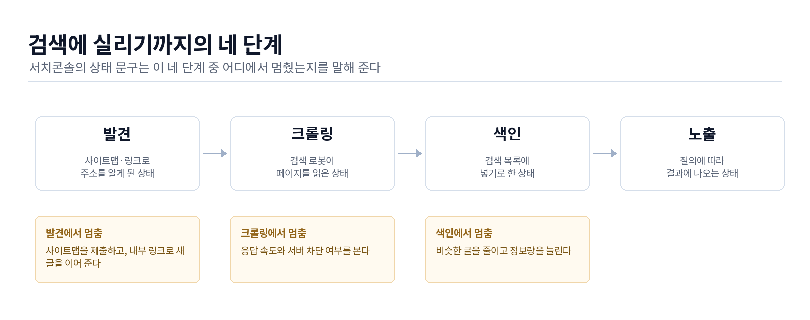

# 07. 검색엔진 등록

글을 발행했다고 검색에 나오지는 않습니다. 검색엔진이 사이트를 발견하고, 크롤링하고, 색인에 넣어야 결과에 나타납니다. 이 네 단계 중 어디에서 멈췄는지를 알려 주는 도구가 서치콘솔과 서치어드바이저입니다.

| 엔진 | 도구 | 이 책에서의 역할 |
| --- | --- | --- |
| 구글 | Search Console | 색인 상태와 검색 유입 |
| 네이버 | 서치어드바이저 | 국내 유입, 소유 확인 |
| 다음 | 검색등록 | 티스토리는 자동 노출 |

세 곳 모두 등록해 두는 편이 좋습니다. 다만 처음부터 모두 신경 쓰면 시간이 부족합니다. 순서는 구글, 네이버, 다음입니다. 구글은 색인 상태를 가장 자세히 알려 주고, 네이버는 국내 블로그 독자가 많으며, 다음은 티스토리를 쓰면 대개 자동으로 처리됩니다.

이 장이 끝나면 각 도구에서 확인해야 할 화면과, 수치가 이상할 때 무엇을 먼저 보는지 알게 됩니다. 등록 자체는 한 번이면 끝나지만, 상태를 읽는 일은 매주 반복됩니다.
