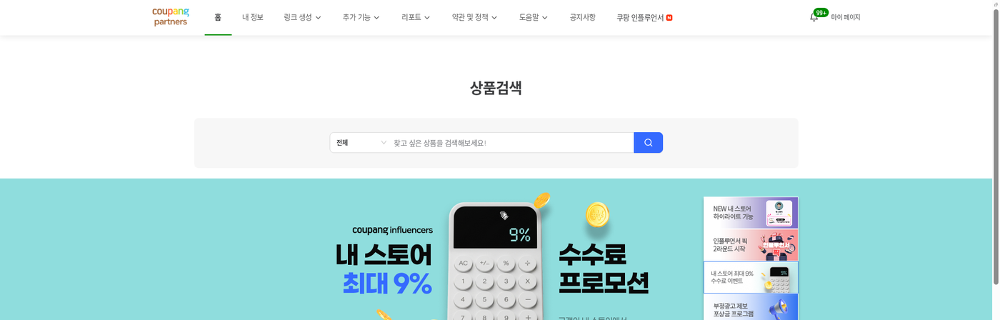

# 08-1. 쿠팡파트너스 시작하기

## 이 절에서 하는 일

쿠팡파트너스에 가입하고, 내 블로그에 붙일 수 있는 링크를 만드는 과정을 정리합니다. 가입은 사람이 하고, 링크 생성과 글 배치는 피클에게 맡깁니다.

## 순서

1. 쿠팡파트너스 홈페이지에서 가입합니다. 쿠팡 계정이 있으면 그대로 쓸 수 있습니다.
2. 정산 정보와 활동 정보를 입력합니다. 활동 채널에 내 블로그 주소를 넣습니다.
3. 승인이 나면 링크 생성 도구를 씁니다.
4. 상품을 골라 링크를 만들고, 글에 넣습니다.



위 화면은 로그인 후의 메인 화면입니다. 링크 생성 도구는 상단 메뉴에서 열 수 있습니다. 계정 정보는 가려 두었습니다.

## 이렇게 말하면 됩니다

```
쿠팡파트너스 링크를 글에 붙이는 작업을 맡겨 줘.
- 글 하나당 링크는 1개만
- 쿠팡 링크와 다른 제휴 링크를 번갈아 배치
- 글 성격과 맞지 않는 상품은 넣지 않기
- 고지 문구를 글 맨 아래에 고정으로 넣기
지금 발행된 글 중에 링크가 여러 개 들어간 글이 있으면 알려 줘.
```

## 피클이 되묻는 것

| 피클의 질문 | 내가 고르는 답 |
| --- | --- |
| 어떤 글에 링크를 넣을까요 | 검색 유입이 있는 글부터 |
| 상품은 무엇으로 할까요 | 글 주제와 맞는 상품 하나 |
| 링크를 새 창으로 열까요 | 새 창으로 열기 |

## 링크를 넣을 때의 규칙

| 규칙 | 이유 |
| --- | --- |
| 글당 하나 | 여러 개가 붙으면 광고로 보입니다 |
| 교차 배치 | 같은 상품만 반복되면 신뢰가 떨어집니다 |
| 본문 흐름 안에 | 링크만 나열하면 읽지 않습니다 |
| 고지 문구 함께 | 표시 의무가 있습니다 |

## 링크를 만드는 방법

1. 쿠팡파트너스에서 상품을 검색합니다.
2. 링크 생성을 누릅니다.
3. 짧은 링크나 버튼 코드를 복사합니다.
4. 글의 해당 위치에 붙입니다.

피클에게는 "이 글에는 이 상품 링크를 붙여 줘"처럼 상품과 글을 짝지어 말하면 됩니다.

## 잘 안 될 때는 이렇게 말합니다

- "링크가 눌러도 안 열려."라고 하면 링크의 추적 코드가 살아 있는지 확인합니다.
- "가입이 반려됐어."라고 하면 활동 채널과 사이트 정보를 다시 채웁니다.
- "어떤 상품을 넣어야 할지 모르겠어."라고 하면 글 주제와 검색어를 보고 후보를 제안받습니다.
