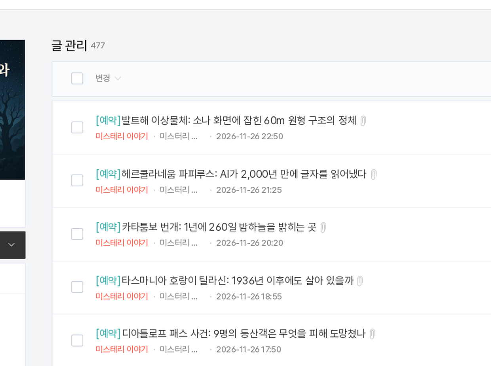

# 09-1. 하루 발행 파이프라인 만들기

## 이 절에서 하는 일

매일 같은 시각에 발행이 시작되고, 끝나면 결과가 보고되는 구조를 만듭니다. 사용자는 아침에 표 한 장을 받습니다.

## 하루의 흐름

| 시각 | 하는 일 | 사람이 하는 일 |
| --- | --- | --- |
| 07:15 | 티스토리 3곳 발행 시작 | 없음 |
| 07:30 | 첫 편 공개, 나머지 예약 | 없음 |
| 07:45 | 워드프레스 발행 시작 | 없음 |
| 08:00 | 결과 보고 | 표를 읽고 이상한 항목만 확인 |
| 하루 중 | 예약된 글이 순서대로 공개 | 없음 |
| 밤 | 실패한 편이 있으면 재시도 | 없음 |

## 이렇게 말하면 됩니다

```
매일 아침 발행이 자동으로 돌게 해 줘.
- 07:15에 티스토리 3곳, 07:45에 워드프레스
- 각 블로그 10편, 첫 편 공개 + 나머지 40~120분 간격 예약
- 끝나면 성공·실패·건너뜀을 표로 보고
- 실패한 편은 내가 따로 시키지 않아도 저녁에 한 번 더 시도
보고는 내가 읽기 쉽게 블로그별로 나눠 줘.
```

## 피클이 되묻는 것

| 피클의 질문 | 내가 고르는 답 |
| --- | --- |
| 주말에도 돌릴까요 | 매일 돌리기 |
| 실패하면 몇 번까지 다시 시도할까요 | 저녁에 한 번 |
| 보고는 어디로 받을까요 | 채팅으로 |

## 실제 화면



글 관리 화면을 열면 하루치 예약이 이렇게 잡혀 있습니다. 시각이 고르게 퍼져 있고, 상태가 예약으로 표시되면 정상입니다.

## 아침 보고의 예

| 블로그 | 성공 | 실패 | 비고 |
| --- | --- | --- | --- |
| 티스토리 A | 10 | 0 | 첫 편 공개 완료 |
| 티스토리 B | 10 | 0 | 22:40 마지막 예약 |
| 티스토리 C | 9 | 1 | 이미지 업로드 실패, 저녁 재시도 |
| 워드프레스 | 10 | 0 | 대표이미지 정상 |

이 표만 보면 오늘 무엇이 문제였는지 알 수 있습니다. 실패 항목이 없으면 표를 읽고 넘어가면 됩니다.

## 잘 안 될 때는 이렇게 말합니다

- "아침 보고가 안 왔어."라고 하면 루틴이 등록되어 있는지 확인합니다.
- "매일 같은 시간에 몰려서 올라가."라고 하면 간격 계산을 다시 시킵니다.
- "주말에는 쉬고 싶어."라고 하면 요일을 지정해 루틴을 바꿉니다.
