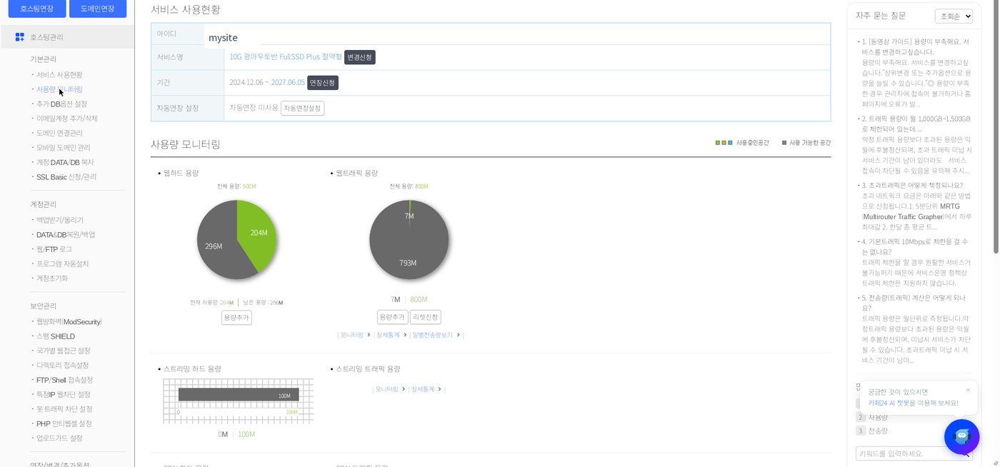
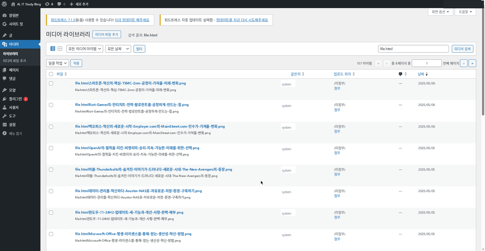

# 09-3. 호스팅 용량과 트래픽 한도 지키기

## 이 절에서 하는 일

자동 발행을 오래 돌리면 반드시 부딪히는 벽이 호스팅 용량과 트래픽입니다. 이 절에서는 한도를 넘지 않게 관리하는 방법과, 넘었을 때의 대응을 다룹니다.

## 두 가지 한도

| 한도 | 뜻 | 넘으면 |
| --- | --- | --- |
| 저장 용량 | 이미지와 파일이 차지하는 공간 | 새 이미지 업로드가 실패 |
| 일일 트래픽 | 하루에 주고받은 데이터 양 | 사이트 전체가 일시 차단 |

저장 용량은 천천히 차고, 트래픽은 하루아침에 넘을 수 있습니다. 실제로 큰 이미지를 한꺼번에 내려받다가 하루 트래픽을 넘겨 사이트가 멈춘 사례가 있습니다.



위 화면에서 저장 용량과 트래픽 사용량을 확인합니다. 사용량이 한도의 80%를 넘으면 이미지 정리가 필요합니다.

## 이미지가 용량을 먹는 이유

대표이미지 한 장이 2MB라면, 150편이면 300MB입니다. 여기에 본문 이미지가 더해집니다. 반대로 같은 이미지를 300KB로 줄이면 150편이 45MB로 줄어듭니다.

| 항목 | 큰 이미지 | 줄인 이미지 |
| --- | --- | --- |
| 장당 크기 | 2MB | 300KB |
| 150편 대표이미지 | 300MB | 45MB |
| 업로드 속도 | 느림 | 빠름 |
| 트래픽 부담 | 큼 | 작음 |



미디어 목록에서 파일 크기 순으로 정렬하면 큰 파일이 먼저 보입니다. 오래된 큰 파일부터 줄이거나 교체합니다.

## 이렇게 말하면 됩니다

```
호스팅 용량과 트래픽을 관리해 줘.
- 매주 저장 용량과 트래픽 사용량을 알려 주기
- 80%를 넘으면 큰 이미지부터 찾아서 줄이기
- 이미지 한 장은 300KB 이하로 유지
- 트래픽이 넘어 사이트가 멈추면 원인과 복구 시각을 알려 주기
```

## 피클이 되묻을 것

| 피클의 질문 | 내가 고르는 답 |
| --- | --- |
| 오래된 이미지를 지울까요 | 글에 쓰인 것은 남기고 대체 |
| 유료로 늘릴까요 | 무료 복구를 먼저 시도 |
| 알림은 언제 받을까요 | 80%에 도달하면 |

## 트래픽이 넘었을 때

1. 사이트가 멈춘 시각과 원인을 확인합니다.
2. 한도가 일일 단위라면 자정에 풀립니다. 급하지 않으면 기다립니다.
3. 급하면 호스팅의 즉시 초기화를 씁니다. 비용이 들 수 있으므로 사용자가 결정합니다.
4. 복구 뒤에 원인이 된 작업을 다시 하지 않도록 규칙을 바꿉니다.

## 잘 안 될 때는 이렇게 말합니다

- "이미지를 올리면 실패해."라고 하면 저장 용량을 확인합니다.
- "사이트가 갑자기 안 열려."라고 하면 트래픽 초과인지 먼저 확인합니다.
- "용량이 계속 늘어나."라고 하면 큰 파일 목록을 뽑아 정리합니다.
