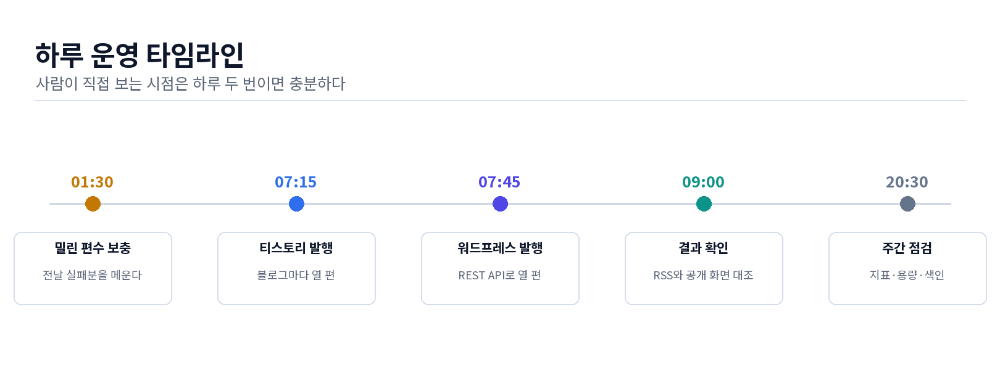

# 09-4. 주간 점검 받기

## 이 절에서 하는 일

매일 보는 표와 별개로, 일주일에 한 번은 큰 흐름을 봅니다. 이 절에서는 주간 점검에서 무엇을 보고 무엇을 바꾸는지 정리합니다.

## 주간 점검에서 보는 다섯 가지

| 항목 | 보는 이유 | 판단 기준 |
| --- | --- | --- |
| 발행량 | 계획대로 돌았는지 | 목표의 90% 이상 |
| 색인 수 | 글이 검색에 들어갔는지 | 지난주보다 증가 |
| 유입 | 어디서 들어오는지 | 검색 비중이 늘어나는지 |
| 수익 | 광고와 제휴 비중 | 한쪽에 몰리지 않았는지 |
| 실패 로그 | 같은 원인이 반복되는지 | 같은 원인 3회 이상 |



## 이렇게 말하면 됩니다

```
지난 한 주를 정리해서 보고해 줘.
- 블로그별 발행 편수와 실패 편수
- 색인된 페이지 수 변화
- 유입이 많은 글 다섯 개
- 광고 수익과 제휴 클릭 수
- 반복되는 실패 원인
다음 주에 바꿀 것 두 가지만 추천해 줘.
```

## 피클이 되묻는 것

| 피클의 질문 | 내가 고르는 답 |
| --- | --- |
| 지난주와 비교할까요 | 네, 변화량 중심으로 |
| 추천은 몇 개까지 | 두 개 |
| 보고는 언제 받을까요 | 월요일 아침 |

## 보고 예시

| 항목 | 지난주 | 이번 주 | 변화 |
| --- | --- | --- | --- |
| 발행 | 280편 | 300편 | +20 |
| 색인 | 120 | 168 | +48 |
| 검색 유입 | 320 | 610 | +290 |
| 광고 수익 | 1,200원 | 1,900원 | +700원 |
| 제휴 클릭 | 14 | 25 | +11 |

이 표에서 다음 주에 할 일을 두 개만 고릅니다. 예를 들어 "색인이 늘어난 글의 주제로 3편 더 쓰기", "제휴 클릭이 많은 글에 링크 하나 추가"처럼 구체적으로 정합니다.

## 실패 로그를 읽는 법

같은 실패가 반복되면 원고 문제인지 화면 문제인지 나눠 봅니다.

| 실패 원인 | 성격 | 대응 |
| --- | --- | --- |
| 이미지 업로드 실패 | 화면 | 이미지 크기와 형식 통일 |
| 발행 중 멈춤 | 화면 | 한 번에 보내는 편수 줄이기 |
| 본문이 빔 | 화면 | 붙여넣기 경로 확인 |
| 규격 위반 | 원고 | 규격표를 원고 생성에 다시 넣기 |

## 잘 안 될 때는 이렇게 말합니다

- "보고가 매주 비슷해."라고 하면 비교 기준을 바꿔 달라고 합니다.
- "숫자가 이해가 안 돼."라고 하면 지표의 뜻을 풀어서 설명해 달라고 합니다.
- "바꿀 것을 너무 많이 추천해."라고 하면 두 개로 줄이게 합니다.
