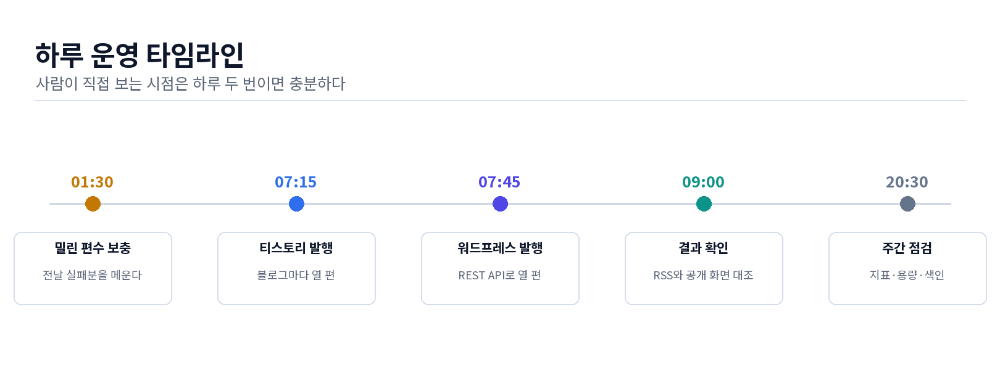

# 09. 매일 도는 운영 체계

자동화를 만들었다고 해서 운영이 끝나는 것은 아닙니다. 매일 도는 절차에는 세 가지가 필요합니다. 실패했을 때 어디서 멈췄는지 아는 것, 비용이 한도를 넘지 않는 것, 사람이 확인할 지점을 정해 두는 것.

이 장은 실제로 사흘간 자동 발행을 돌리면서 겪은 일을 기준으로 썼습니다. 잘 돌아간 날의 기록보다 멈춘 날의 기록이 더 많습니다. 그 기록에서 뽑은 규칙이 이 장의 내용입니다.

| 문제 | 원인 | 규칙 |
| --- | --- | --- |
| 발행이 중간에 멈춤 | 입력 길이 한도 | 원고를 배치로 나눔 |
| 같은 글이 두 번 올라감 | 상태 파일 미갱신 | 슬러그 확인 후 발행 |
| 사이트 전체 503 | 이미지 다운로드로 트래픽 초과 | 큰 작업은 한도 확인 후 |
| 예약 시각 어긋남 | 서버 시간대 | 시간대를 명시해 전송 |

이 장을 마치면 하루 운영을 스스로 점검할 수 있게 됩니다. 특별한 도구는 필요 없고, 표와 파일 하나면 충분합니다.
