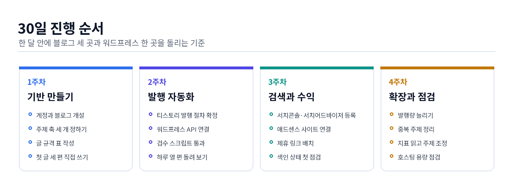

# 10-1. 프로젝트 설계

## 이 절에서 하는 일

30일 동안 무엇을 어디까지 할지 정합니다. 계획 없이 시작하면 3주쯤에 손을 놓게 됩니다. 목표를 숫자로 적어 두면 중간에 흔들리지 않습니다.

## 목표를 숫자로 적습니다

| 항목 | 30일 목표의 예 | 판단 기준 |
| --- | --- | --- |
| 블로그 수 | 티스토리 3곳, 워드프레스 1곳 | 계정 구조가 정리됨 |
| 하루 발행 | 티스토리 30편, 워드프레스 10편 | 자동 루틴이 등록됨 |
| 글 품질 | 규격 위반 5% 이하 | 검수 표로 확인 |
| 검색 등록 | 세 검색엔진 모두 | 색인 수가 늘어남 |
| 수익 | 광고 승인 1곳 이상 | 승인 또는 검토 중 |
| 제휴 | 글당 1링크, 고지 100% | 고지 누락 0건 |

처음 시작하는 사람은 이 표의 절반만 잡아도 충분합니다. 예를 들어 블로그 한 곳, 하루 3편으로 시작해도 30일 계획은 성립합니다.

## 이렇게 말하면 됩니다

```
30일 블로그 자동화 계획을 세워 줘.
- 지금 상태(블로그 수, 하루 투자 가능 시간)를 먼저 물어봐
- 주차별 목표와 하루 할 일을 표로 정리
- 각 주차 끝에 확인할 항목을 함께 적기
- 내가 승인하면 그 일정대로 진행 상황을 매일 보고
```

## 피클이 되묻는 것

| 피클의 질문 | 내가 고르는 답 |
| --- | --- |
| 하루에 얼마나 쓸 수 있나요 | 30분, 1시간, 2시간 중 선택 |
| 블로그는 몇 곳인가요 | 운영 중인 곳의 수 |
| 수익화는 언제부터 할까요 | 2주차 또는 3주차 |

## 일정표의 기본형

| 주 | 월 | 화 | 수 | 목 | 금 | 토 | 일 |
| --- | --- | --- | --- | --- | --- | --- | --- |
| 1주 | 계정 정리 | 블로그 개설 | 첫 글 3편 | 규격표 | 로그인 연결 | 점검 | 휴식 |
| 2주 | 발행 시험 | 예약 간격 | 10편 발행 | 실패 대응 | 자동 루틴 | 점검 | 휴식 |
| 3주 | 애드센스 신청 | 검색 등록 | 제휴 가입 | 고지 규칙 | 점검 | 점검 | 휴식 |
| 4주 | 주간 보고 | 지표 읽기 | 개선 2건 | 확장 | 최종 점검 | 정리 | 휴식 |

일요일은 비워 둡니다. 자동 발행은 돌아가지만 사람은 쉬는 날이 있어야 다음 주가 됩니다.



## 잘 안 될 때는 이렇게 말합니다

- "계획이 너무 빡빡해."라고 하면 하루 할 일을 하나로 줄입니다.
- "중간에 며칠을 못 했어."라고 하면 남은 일정을 다시 배치합니다.
- "목표를 낮추고 싶어."라고 하면 블로그 수나 발행량을 줄여 다시 짭니다.
