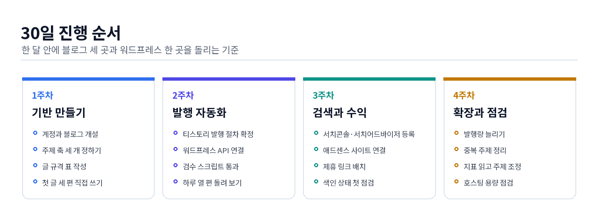

# 10. 실전 프로젝트: 30일 완주

앞의 아홉 장은 재료였습니다. 이 장은 그것을 한 달 일정으로 묶습니다. 목표는 거창하지 않습니다. 30일 뒤에 다음 상태에 도달하는 것입니다.

- 티스토리 블로그 세 곳에 글이 각각 서른 편 이상 있다
- 워드프레스 한 곳에 스무 편 이상 있고, 예약 발행이 걸려 있다
- 사이트 네 곳 모두 검색엔진에 등록되어 있다
- 애드센스 검토가 요청된 상태이거나 승인되었다
- 사람이 하루 두 번, 10분씩 확인하는 체계가 돌고 있다

## 이 프로젝트를 진행하는 방식

매주 끝에 확인할 것이 있습니다. 확인되지 않으면 다음 주로 넘어가지 않습니다. 늦게 가는 것보다 순서를 어기는 것이 더 비쌉니다.

| 주 | 주제 | 끝났을 때 확인 |
| --- | --- | --- |
| 1 | 기반 | 블로그 네 곳에서 글이 보인다 |
| 2 | 자동화 | 하루 열 편이 사람 손 없이 올라간다 |
| 3 | 검색·수익 | 네 곳 모두 등록, 애드센스 요청 |
| 4 | 확장·측정 | 지표 표가 채워지고 중복이 정리된다 |

## 시간 배분

하루에 1~2시간을 쓴다고 가정합니다. 대부분의 시간은 첫 주에 듭니다. 둘째 주부터는 확인과 조정이 중심입니다.

| 주 | 하루 평균 | 주요 작업 |
| --- | --- | --- |
| 1 | 2시간 | 개설, 설정, 규격 정하기 |
| 2 | 1시간 30분 | 절차 확정, 첫 자동 발행 |
| 3 | 1시간 | 등록, 승인 요청, 배치 조정 |
| 4 | 40분 | 점검, 정리, 지표 |

이 장의 각 절은 그 주에 할 일을 순서대로 적었습니다. 체크박스로 표시해 두었으니, 끝난 항목을 지워 가며 진행하십시오.
